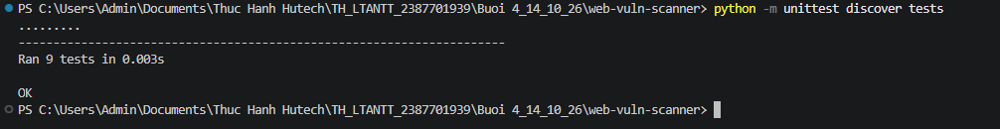
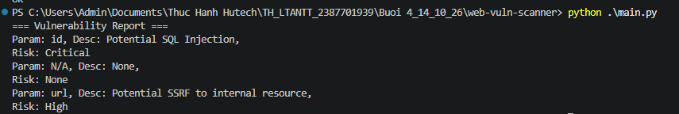
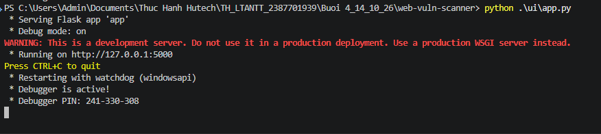
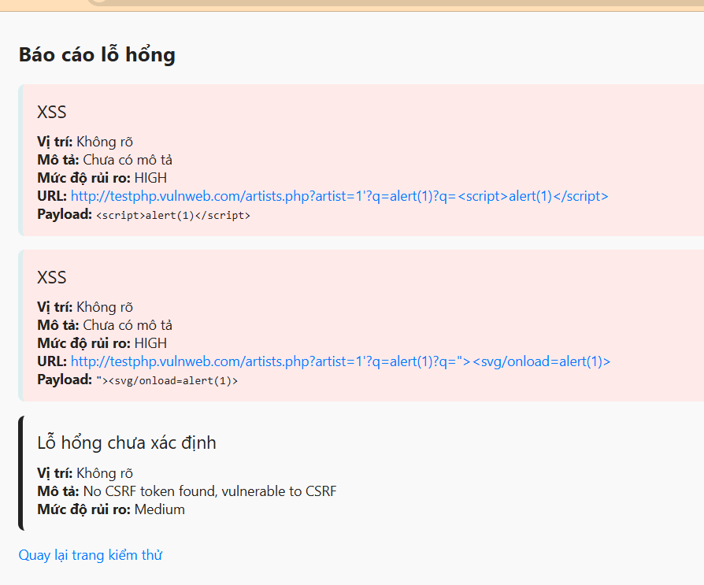

# 🛡️ BÁO CÁO THỰC HÀNH BUỔI 4: BẢO MẬT WEB APP VÀ API

> **Học phần:** Lập trình An toàn Thông tin (LTANTT)  
> **Sinh viên thực hiện:** Trần Tăng Trường Thịnh  
> **MSSV:** 2387701939  
> **Ngày thực hiện:** 14/10/2026  
> **Trường:** Đại học Công nghệ TP.HCM (HUTECH)  

---

## 📑 Mục lục nội dung

1. [Tổng quan nội dung thực hành](#1-tổng-quan-nội-dung-thực-hành)
2. [Cấu trúc thư mục Lab 4](#2-cấu-trúc-thư-mục-lab-4)
3. [Phần 1: 4.2 THỰC HÀNH: WEBVULNSCANNER (Hình 1 - Hình 4)](#3-phần-1-42-thực-hành-webvulnscanner)
   - [3.1. Chạy và kiểm tra UnitTest tự động (Hình 1)](#31-chạy-và-kiểm-tra-unittest-tự-động)
   - [3.2. Chạy kiểm tra chương trình chính CLI (Hình 2)](#32-chạy-kiểm-tra-chương-trình-chính-cli)
   - [3.3. Khởi động Web UI và kết quả rà quét lỗ hổng (Hình 3 - Hình 4)](#33-khởi-động-web-ui-và-kết-quả-rà-quét-lỗ-hổng)
   - [3.4. Báo cáo phân tích chuyên sâu các lỗ hổng XSS và CSRF](#34-báo-cáo-phân-tích-chuyên-sâu-các-lỗ-hổng-xss-và-csrf)
4. [Phần 2: 4.4 THỰC HÀNH: JWTSECURE (Hình 5 - Hình 8)](#4-phần-2-44-thực-hành-jwtsecure)
   - [4.1. Chạy kiểm thử với PyTest (Hình 5)](#41-chạy-kiểm-thử-với-pytest)
   - [4.2. Khởi tạo Token và kích hoạt API Gateway (Hình 6)](#42-khởi-tạo-token-và-kích-hoạt-api-gateway)
   - [4.3. Xác thực API Gateway với Access Token hợp lệ (Hình 7)](#43-xác-thực-api-gateway-với-access-token-hợp-lệ)
   - [4.4. Cơ chế chặn Token giả mạo/không hợp lệ (Hình 8)](#44-cơ-chế-chặn-token-giả-mạokhông-hợp-lệ)
5. [Tổng kết và giải pháp an toàn](#5-tổng-kết-và-giải-pháp-an-toàn)

---

## 1. Tổng quan nội dung thực hành

Buổi thực hành số 4 tập trung giải quyết hai mảng phòng thủ quan trọng bậc nhất trong an toàn ứng dụng mạng:
1. **Dò quét và phân tích lỗ hổng Web (Dynamic Application Security Testing - DAST):** Tự động phát hiện các lỗ hổng hàng đầu OWASP như **Cross-Site Scripting (XSS)** và **Cross-Site Request Forgery (CSRF)** trên ứng dụng Web bằng bộ công cụ `WebVulnScanner`.
2. **Bảo mật giao tiếp API bằng JSON Web Token (JWT):** Xây dựng kiến trúc xác thực không trạng thái (**Stateless Authentication**) theo chuẩn OAuth 2.0, bảo vệ tài nguyên nhạy cảm thông qua cổng kết nối **API Gateway** với thuật toán ký `HS256`.

---

## 2. Cấu trúc thư mục Lab 4

```text
Buoi 4_14_10_26/
├── images/                         # Thư mục hình ảnh tổng hợp Buổi 4
│   ├── image1.png
│   ├── image2.png
│   ├── image3.png
│   ├── image4.png
│   ├── image5.png
│   ├── image6.png
│   ├── image7.png
│   └── image8.png
├── web-vuln-scanner/               # Phần 4.2: Công cụ dò quét lỗ hổng ứng dụng Web
│   ├── report/                     # Module tạo báo cáo tổng hợp kết quả quét
│   │   ├── __init__.py
│   │   └── report_generator.py
│   ├── scanners/                   # Các module quét lỗ hổng chuyên biệt
│   │   ├── __init__.py
│   │   ├── csrf_detector.py        # Kiểm tra Anti-CSRF Token trong HTML form
│   │   ├── sql_injection_tester.py # Kiểm tra SQL Injection qua tham số URL
│   │   ├── ssrf_tester.py          # Phát hiện nguy cơ SSRF truy cập mạng nội bộ
│   │   └── xss_scanner.py          # Kiểm thử chèn mã độc XSS
│   ├── tests/                      # Bộ UnitTest kiểm thử tự động
│   ├── ui/                         # Giao diện Web Flask
│   │   ├── templates/
│   │   │   ├── index.html
│   │   │   └── result.html
│   │   └── app.py
│   ├── main.py                     # Script thực thi quét mẫu trên Terminal
│   ├── requirements.txt            # Danh sách thư viện phụ thuộc
│   ├── images/                     # Ảnh thực thi cho WebVulnScanner
│   └── README.md                   # Hướng dẫn chi tiết WebVulnScanner
├── jwt-security-tools/             # Phần 4.4: Bộ công cụ xác thực an toàn với JWT
│   ├── api_gateway/                # API Gateway chặn lọc Bearer Token
│   │   ├── __init__.py
│   │   └── gateway.py              # Endpoint bảo vệ /protected
│   ├── jwt_cracker/                # Module tấn công dò mật mã JWT
│   ├── jwt_validator/              # Module thẩm định chữ ký và thời hạn token
│   ├── oauth_client/               # Client tuân thủ chuẩn luồng xác thực OAuth 2.0
│   ├── token_manager/              # Quản lý Access Token và Refresh Token
│   ├── tests/                      # Bộ kiểm thử tự động PyTest
│   ├── main.py                     # Sinh Token và khởi động API Gateway Server
│   ├── pytest.ini
│   ├── requirements.txt
│   ├── images/                     # Ảnh thực thi cho JWT Secure
│   └── README.md                   # Hướng dẫn chi tiết JWT Secure
├── BaoCaoBuoi4.docx                # Báo cáo thực hành gốc dạng Word
└── README.md                       # Tài liệu tổng quan Buổi 4 (file này)
```

---

## 3. Phần 1: 4.2 THỰC HÀNH: WEBVULNSCANNER

### 3.1. Chạy và kiểm tra UnitTest tự động

Di chuyển vào thư mục `web-vuln-scanner` và chạy kiểm thử tự động:

```powershell
cd "Buoi 4_14_10_26\web-vuln-scanner"
python -m unittest discover tests
```

  
*Hình 1: Chạy và kiểm tra unittest - Toàn bộ 9/9 test cases đều vượt qua thành công (OK)*

---

### 3.2. Chạy kiểm tra chương trình chính CLI

Thực thi kịch bản quét mẫu qua dòng lệnh Console:

```powershell
python main.py
```

  
*Hình 2: Chạy kiểm tra chương trình chính (main.py) trên Terminal*

---

### 3.3. Khởi động Web UI và kết quả rà quét lỗ hổng

Khởi động máy chủ giao diện người dùng:

```powershell
python ui/app.py
```

  
*Hình 3: Chạy kiểm tra web UI khởi động tại `http://127.0.0.1:5000/`*

Truy cập trình duyệt web, nhập endpoint kiểm thử `http://127.0.0.1:5000/demo-xss` và bấm **Bắt đầu kiểm thử**:

  
*Hình 4: Kết quả quét lỗ hổng bảo mật Web trên giao diện Web Vulnerability Scanner*

---

### 3.4. Báo cáo phân tích chuyên sâu các lỗ hổng XSS và CSRF

Tiến hành kiểm thử bảo mật ứng dụng web thông qua công cụ Web Vulnerability Scanner tại giao diện Web UI (`http://127.0.0.1:5000/`). Công cụ thực hiện rà quét đồng thời các module kiểm thử XSS và CSRF đối với endpoint mục tiêu. Kết quả hệ thống đã phát hiện thành công hai nhóm lỗ hổng:

#### 1. Lỗ hổng Cross-Site Scripting (XSS) - Mức độ: HIGH
- **Cơ chế phát hiện:** Module `XSSScanner` tự động tiêm (inject) các payload XSS chuẩn hóa vào tham số truy vấn `q`. Máy chủ mục tiêu phản chiếu (reflect) trực tiếp nội dung payload về client trong HTTP response mà không qua cơ chế encode/sanitize dữ liệu đầu vào.
- **Các payload khai thác thành công:**
  - **Payload 1:** `<script>alert(1)</script>` — Khai thác thực thi thẻ script trực tiếp.
  - **Payload 2:** `"><svg/onload=alert(1)>` — Kỹ thuật đóng thẻ HTML hiện tại và kích hoạt mã độc qua event handler của thẻ SVG.

#### 2. Lỗ hổng Cross-Site Request Forgery (CSRF) - Mức độ: Medium
- **Cơ chế phát hiện:** Module `CSRFDetector` phân tích cấu trúc HTML của form nhưng không tìm thấy bất kỳ anti-CSRF token hợp lệ nào (chẳng hạn như `csrf_token`, `_csrf`, hoặc `csrfmiddlewaretoken`).
- **Kết luận:** Form thao tác có nguy cơ bị tấn công giả mạo yêu cầu từ phía người dùng hợp lệ nếu không có cơ chế xác thực phiên bổ sung.

---

## 4. Phần 2: 4.4 THỰC HÀNH: JWTSECURE

### 4.1. Chạy kiểm thử với PyTest

Di chuyển vào thư mục `jwt-security-tools` và thực thi:

```powershell
cd "Buoi 4_14_10_26\jwt-security-tools"
pytest
```

  
*Hình 5: Chạy kiểm thử với pytest đạt kết quả 7/7 passed*

---

### 4.2. Khởi tạo Token và kích hoạt API Gateway

Khởi chạy chương trình chính tại Terminal thứ nhất:

```powershell
python main.py
```

  
*Hình 6: Chạy main.py để sinh Access Token và khởi động API Gateway*

---

### 4.3. Xác thực API Gateway với Access Token hợp lệ

Tại cửa sổ Terminal thứ hai, sử dụng PowerShell gửi lệnh:

```powershell
$token = "<DÁN_CHUỖI_ACCESS_TOKEN_TẠI_HÌNH_6>"
Invoke-RestMethod -Uri "http://127.0.0.1:5000/protected" -Headers @{ Authorization = "Bearer $token" }
```

  
*Hình 7: Kiểm tra xác thực API Gateway bằng Access Token JWT hợp lệ*

**Nhận xét phân tích kết quả:**  
Sử dụng lệnh `Invoke-RestMethod` gửi Access Token trong header `Authorization: Bearer <token>` đến endpoint `/protected` tại `http://127.0.0.1:5000`. Kết quả hệ thống trả về thông báo `Access granted` và định danh người dùng `phuoc`, chứng minh JWT hợp lệ, chữ ký token được xác thực thành công và API Gateway cho phép truy cập tài nguyên được bảo vệ.

---

### 4.4. Cơ chế chặn Token giả mạo/không hợp lệ

Gửi yêu cầu mang token không hợp lệ để kiểm tra tính năng bảo vệ:

```powershell
Invoke-RestMethod -Uri "http://127.0.0.1:5000/protected" -Headers @{ Authorization = "Bearer invalid_token" }
```

  
*Hình 8: Kiểm tra cơ chế từ chối Access Token JWT không hợp lệ*

**Nhận xét phân tích kết quả:**  
Gửi request kèm header `Authorization: Bearer invalid_token` tới endpoint `/protected`. Hệ thống xác thực thất bại, trả về mã `401 Unauthorized` cùng thông báo `{"message": "Access denied"}`. Kết quả chứng minh API Gateway chặn thành công token giả mạo.

---

## 5. Tổng kết và giải pháp an toàn

1. **Phòng chống XSS:** Thực hiện mã hóa đầu ra (Output Encoding/Escaping) phù hợp theo ngữ cảnh trình duyệt và triển khai Content Security Policy (CSP).
2. **Phòng chống CSRF:** Áp dụng bắt buộc Anti-CSRF Token hoặc cấu hình thuộc tính Cookie `SameSite=Strict`.
3. **Bảo mật JWT API:** Sử dụng khóa bí mật độ phức tạp cao, phân tách rõ rệt giữa Access Token ngắn hạn và Refresh Token dài hạn, luôn xác thực chữ ký và thời hạn `exp` tại cổng API Gateway.
