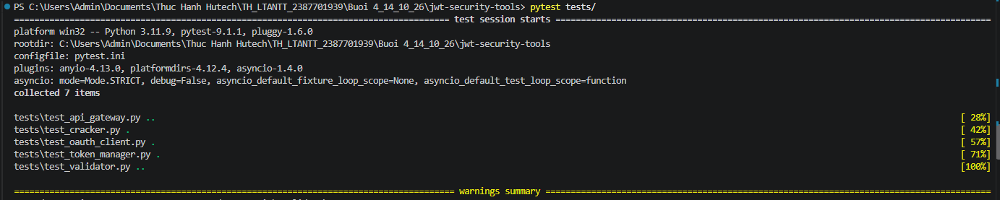
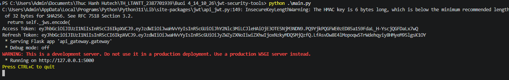
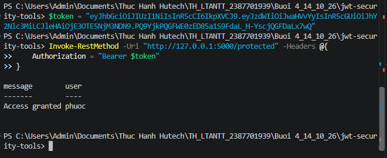
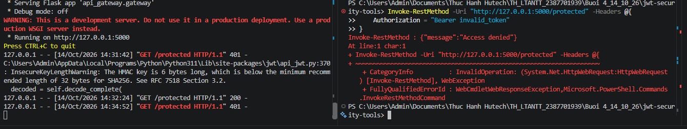

# JWT Security Tools - Bộ công cụ bảo mật và xác thực JSON Web Token (JWT)

> **Học phần:** Lập trình An toàn Thông tin (LTANTT)  
> **Sinh viên thực hiện:** Trần Tăng Trường Thịnh  
> **MSSV:** 2387701939  
> **Bài thực hành:** Buổi 4 - Mục 4.4: Thực hành JWT Secure & API Gateway

---

## 1. Giới thiệu tổng quan

Trong kiến trúc hệ thống hiện đại phân tán (Microservices) và ứng dụng di động/SPA, cơ chế xác thực không trạng thái (**Stateless Authentication**) bằng **JSON Web Token (JWT - RFC 7519)** là giải pháp chuẩn công nghiệp thay thế cho Session-Cookie truyền thống.

**JWT Security Tools** là bộ giải pháp toàn diện bao gồm:
- **Token Manager (`token_manager`):** Quản lý vòng đời đầy đủ của Token theo chuẩn OAuth 2.0: Cấp phát **Access Token** ngắn hạn (15 phút) và **Refresh Token** dài hạn (24 giờ), hỗ trợ cơ chế quay vòng khóa và gia hạn Token an toàn.
- **JWT Validator (`jwt_validator`):** Thẩm định tính hợp lệ của token: Kiểm tra thuật toán ký (`alg: HS256`), xác thực chữ ký mật mã HMAC-SHA256, kiểm tra thời gian hết hạn (`exp`) và tính toàn vẹn của các claims (`iss`, `sub`, `aud`).
- **API Gateway (`api_gateway`):** Cổng trung gian cung cấp Middleware chặn lọc request, phân tích header `Authorization: Bearer <token>`, bảo vệ tài nguyên nhạy cảm tại endpoint `/protected`.
- **JWT Cracker (`jwt_cracker`):** Module kiểm thử tấn công giả lập kỹ thuật Brute-force dò tìm khóa bí mật (Secret Key) yếu của token HMAC đa luồng.
- **OAuth Client (`oauth_client`):** Mô phỏng quy trình ủy quyền Authorization Code Grant chuẩn hóa.

---

## 2. Cấu trúc thư mục

```text
Buoi 4_14_10_26/jwt-security-tools/
├── api_gateway/
│   ├── __init__.py
│   └── gateway.py             # Middleware xác thực Bearer token & endpoint /protected
├── jwt_cracker/
│   ├── __init__.py
│   └── cracker.py             # Kỹ thuật bẻ khóa bí mật JWT bằng từ điển (Dictionary Attack)
├── jwt_validator/
│   ├── __init__.py
│   └── validator.py           # Module thẩm định chữ ký và thời hạn hiệu lực của JWT
├── oauth_client/
│   ├── __init__.py
│   └── client.py              # Luồng tương tác chuẩn OAuth 2.0
├── token_manager/
│   ├── __init__.py
│   └── manager.py             # Cấp phát và gia hạn Access Token / Refresh Token
├── tests/
│   ├── __init__.py
│   ├── test_api_gateway.py    # Kiểm thử xác thực API Gateway
│   ├── test_cracker.py        # Kiểm thử tính năng rà quét khóa yếu
│   ├── test_oauth_client.py   # Kiểm thử luồng client OAuth
│   ├── test_token_manager.py  # Kiểm thử cấp phát và xoay vòng token
│   └── test_validator.py      # Kiểm thử thuật toán xác thực JWT
├── images/
│   ├── image5.png             # Hình 5: Chạy kiểm thử tự động với PyTest
│   ├── image6.png             # Hình 6: Sinh Token và kích hoạt API Gateway (main.py)
│   ├── image7.png             # Hình 7: Xác thực thành công với Access Token hợp lệ (HTTP 200)
│   └── image8.png             # Hình 8: Chặn truy cập với Token không hợp lệ (HTTP 401)
├── main.py                    # Khởi tạo Token và khởi động API Gateway Server
├── pytest.ini                 # Cấu hình môi trường cho PyTest
├── requirements.txt           # Danh sách thư viện phụ thuộc (PyJWT, Flask, pytest, ...)
└── README.md                  # Tài liệu hướng dẫn sử dụng (file này)
```

---

## 3. Cài đặt môi trường

Mở PowerShell tại thư mục `jwt-security-tools`:

```powershell
cd "Buoi 4_14_10_26\jwt-security-tools"
pip install -r requirements.txt
```

---

## 4. Chạy kiểm thử tự động với PyTest

Thực thi bộ kiểm thử tích hợp:

```powershell
pytest
```

  
*Hình 5: Chạy kiểm thử với pytest đạt 100% kết quả thành công (7 passed in 0.22s)*

---

## 5. Hướng dẫn vận hành và Kiểm thử thực tế (Hình ảnh minh chứng)

### 5.1. Khởi chạy máy chủ API Gateway và sinh Token (`main.py`)

Tại cửa sổ Terminal thứ nhất, khởi chạy chương trình chính:

```powershell
python main.py
```

Chương trình sẽ tự động sinh cặp mã token và khởi động máy chủ Flask API Gateway tại địa chỉ `http://127.0.0.1:5000`:
- **Access Token:** Dùng để xác thực các yêu cầu gọi tới tài nguyên bảo vệ.
- **Refresh Token:** Dùng để xin cấp lại Access Token mới khi token cũ hết hạn.

  
*Hình 6: Chạy main.py để sinh Access Token và khởi động API Gateway*

---

### 5.2. Kiểm thử xác thực bằng Access Token hợp lệ (HTTP 200 OK)

Mở cửa sổ Terminal thứ hai (PowerShell) và sử dụng lệnh `Invoke-RestMethod` gửi Access Token vừa sinh trong header `Authorization: Bearer <token>` tới endpoint `/protected`:

```powershell
$token = "<DÁN_CHUỖI_ACCESS_TOKEN_Ở_HÌNH_6_VÀO_ĐÂY>"
Invoke-RestMethod -Uri "http://127.0.0.1:5000/protected" -Headers @{ Authorization = "Bearer $token" }
```

**Phản hồi từ Server:**
```json
{
  "message": "Access granted",
  "user": "phuoc"
}
```

  
*Hình 7: Kiểm tra xác thực API Gateway bằng Access Token JWT hợp lệ*

**Phân tích kết quả:**
Sử dụng lệnh `Invoke-RestMethod` gửi Access Token trong header `Authorization: Bearer <token>` đến endpoint `/protected` tại `http://127.0.0.1:5000`. Kết quả hệ thống trả về thông báo `Access granted` và định danh người dùng `phuoc`, chứng minh JWT hợp lệ, chữ ký token được xác thực thành công và API Gateway cho phép truy cập tài nguyên được bảo vệ.

---

### 5.3. Kiểm thử cơ chế từ chối Token không hợp lệ (HTTP 401 Unauthorized)

Gửi yêu cầu kèm một chuỗi token giả mạo hoặc sai định dạng:

```powershell
Invoke-RestMethod -Uri "http://127.0.0.1:5000/protected" -Headers @{ Authorization = "Bearer invalid_token" }
```

**Phản hồi từ Server:**
Hệ thống xác thực thất bại, trả về mã trạng thái `401 Unauthorized` cùng thông điệp:
```json
{
  "message": "Access denied"
}
```

  
*Hình 8: Kiểm tra cơ chế từ chối Access Token JWT không hợp lệ*

**Phân tích kết quả:**
Gửi request kèm header `Authorization: Bearer invalid_token` tới endpoint `/protected`. Hệ thống xác thực thất bại, trả về mã `401 Unauthorized` cùng thông báo `{"message": "Access denied"}`. Kết quả chứng minh API Gateway chặn thành công token giả mạo, bảo vệ an toàn cho tài nguyên phía sau Gateway.

---

## 6. Kết luận

Hệ thống **JWT Security Tools** cung cấp nền tảng kiến trúc xác thực API vững chắc:
- **Chu kỳ sống token an toàn:** Access token ngắn hạn giảm thiểu rủi ro khi bị chặn bắt lưu lượng mạng.
- **Toàn vẹn dữ liệu:** Thuật toán ký số HMAC-SHA256 (`HS256`) đảm bảo dữ liệu trong payload không thể bị kẻ xấu chỉnh sửa trái phép (Tamper-proof).
- **Phòng chống tấn công:** Tích hợp kiểm tra thời hạn sống `exp` theo thời gian thực (Unix timestamp UTC) ngăn chặn các cuộc tấn công phát lại (Replay Attacks).
