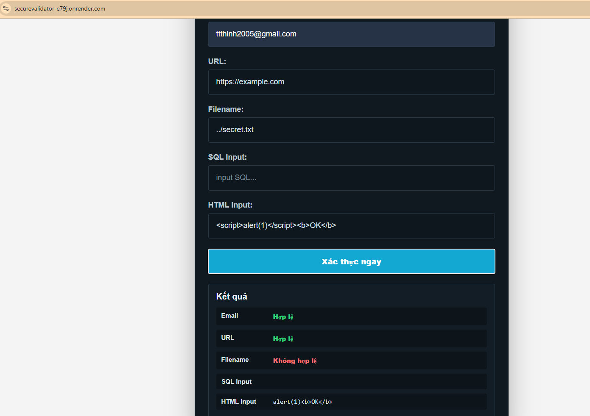

# Lab 1 - Thư viện xác thực đầu vào SecureValidator

> **Học phần:** Lập trình An toàn Thông tin (LTANTT)  
> **Sinh viên thực hiện:** Trần Tăng Trường Thịnh  
> **MSSV:** 2387701939  
> **Bài thực hành:** Buổi 1 - Mục 1.2: Thư viện xác thực đầu vào (SecureValidator)

---

## 1. Giới thiệu tổng quan

Bài thực hành nhằm mục tiêu xây dựng một thư viện Python độc lập mang tên `SecureValidator` có khả năng kiểm tra (validate) và làm sạch (sanitize) toàn diện dữ liệu đầu vào. Việc xử lý triệt để dữ liệu đầu vào ngay tại biên ứng dụng giúp ngăn chặn từ sớm các nguy cơ bảo mật nghiêm trọng trong danh mục OWASP Top 10 như:
- **Injection Attacks:** SQL Injection, Command Injection thông qua chuỗi truy vấn.
- **Server-Side Request Forgery (SSRF):** Truy cập trái phép vào các địa chỉ loopback hoặc dải IP mạng nội bộ.
- **Path Traversal:** Truy xuất tệp tin hệ thống nhạy cảm bằng kỹ thuật thoát thư mục (`../`).
- **Cross-Site Scripting (XSS):** Tiêm mã HTML/JavaScript độc hại vào nội dung phản hồi.

---

## 2. Cấu trúc thư mục

```text
Buoi1_23_9_26/Lab 1/
├── app.py                     # Ứng dụng Flask demo giao diện người dùng Web UI
├── requirements.txt           # Danh sách các gói phụ thuộc (Flask, gunicorn, ...)
├── render.yaml                # Cấu hình triển khai tự động lên Render Cloud
├── MOTA_CHUCNANG_LAB1.txt     # Bảng đặc tả chi tiết chức năng bài Lab 1
├── HinhAnh.docx               # Báo cáo Word đính kèm hình ảnh thực thi
├── images/
│   └── image1.png             # Hình ảnh giao diện Web UI kiểm thử đầu vào
├── securevalidator/
│   ├── __init__.py            # Khởi tạo package SecureValidator
│   └── core.py                # Mã nguồn triển khai toàn bộ các hàm xác thực và làm sạch
├── templates/
│   └── index.html             # Giao diện kiểm thử trực quan với 5 form dữ liệu
└── tests/
    └── test_validators.py     # Bộ unit test tự động (8 test cases)
```

---

## 3. Các hàm chức năng cốt lõi (`securevalidator/core.py`)

| Tên hàm | Tham số | Giá trị trả về | Cơ chế bảo mật và mục đích |
|---|---|---|---|
| `validate_email` | `email: str` | `bool` | Kiểm tra định dạng RFC 5322 chuẩn hóa, chặn ký tự điều khiển (`\n`, `\r`) và các chuỗi injection độc hại. |
| `validate_url` | `url: str` | `bool` | Chỉ chấp nhận giao thức an toàn `http` / `https`. Chặn truy cập tới dải IP loopback (`127.0.0.1`, `localhost`) và dải IP nội bộ RFC 1918 để ngăn chặn tấn công SSRF. |
| `validate_filename` | `filename: str` | `bool` | Kiểm tra tên tệp an toàn, ngăn chặn ký tự vượt thư mục (`../`, `..\\`), URL encoding (`%2f`) và ký tự điều khiển nguy hiểm. |
| `sanitize_sql_input` | `input_str: str` | `str` | Loại bỏ các từ khóa và ký hiệu đặc biệt dùng trong SQL Injection: `'`, `"`, `;`, `--`, `/*`, `DROP`, `UNION`, `SELECT`. |
| `sanitize_html_input` | `html_str: str` | `str` | Mã hóa các ký tự nhạy cảm (`<`, `>`, `&`, `"`, `'`) hoặc bóc tách các thẻ `<script>`, `<iframe>` và các event handler nguy hiểm (`onload`, `onerror`) để phòng chống XSS. |

---

## 4. Hướng dẫn cài đặt và chạy ứng dụng

### 4.1. Cài đặt môi trường

Mở PowerShell tại thư mục Lab 1:

```powershell
cd "Buoi1_23_9_26\Lab 1"
pip install -r requirements.txt
```

### 4.2. Chạy kiểm thử tự động (Unit Tests)

Thực thi bộ 8 bài kiểm thử với `unittest`:

```powershell
python -m unittest discover tests
```

**Kết quả thực thi mong đợi:**

```text
........
----------------------------------------------------------------------
Ran 8 tests in 0.012s

OK
```

*Ý nghĩa:* 8 dấu chấm đại diện cho 8 bài kiểm tra chuyên sâu (kiểm tra email chuẩn/độc hại, kiểm tra URL public/SSRF, kiểm tra tên file an toàn/path traversal, làm sạch chuỗi SQL injection, và làm sạch mã HTML chống XSS) đều vượt qua thành công (`OK`).

### 4.3. Chạy ứng dụng Web UI Flask

Khởi động máy chủ Flask cục bộ:

```powershell
python app.py
```

Truy cập trên trình duyệt web tại:
```text
http://127.0.0.1:5000/
```

Hoặc truy cập bản demo trực tuyến đã deploy trên Render:
- **Demo trực tuyến:** https://securevalidator-e79j.onrender.com

---

## 5. Kết quả kiểm thử thực tế (Hình ảnh minh chứng)

Dưới đây là hình ảnh kết quả thực thi kiểm thử các trường dữ liệu trên giao diện Web UI, trích xuất từ file báo cáo `HinhAnh.docx`:


*Hình 1: Kết quả kiểm tra và làm sạch dữ liệu đầu vào trên giao diện Web UI của SecureValidator*

### Bảng phân tích chi tiết kết quả kiểm thử trên giao diện

| Trường dữ liệu | Giá trị nhập vào | Kết quả hệ thống | Phân tích cơ chế an toàn |
|---|---|---|---|
| **Email** | `admin@example.com; DROP TABLE users` | **Không hợp lệ** | Phát hiện ký tự `;` và mẫu truy vấn SQL chèn trong địa chỉ email. |
| **URL** | `http://127.0.0.1/admin` | **Không hợp lệ** | Phát hiện IP `127.0.0.1` (loopback/internal), ngăn chặn SSRF truy cập tài nguyên nội bộ. |
| **Filename** | `../../etc/passwd` | **Không hợp lệ** | Phát hiện dấu phân cách `../` chỉ định thoát thư mục cha (Path Traversal). |
| **SQL Input** | `' OR 1=1; DROP TABLE users --` | Chuỗi đã làm sạch | Loại bỏ các ký tự nháy đơn, dấu chấm phẩy, comment `--` và từ khóa `DROP TABLE`. |
| **HTML Input** | `<script>alert(1)</script><b>OK</b>` | `<b>OK</b>` (hoặc HTML Entity) | Toàn bộ mã Javascript thực thi `<script>` bị bóc tách hoặc escape an toàn, chỉ giữ lại định dạng văn bản an toàn. |

---

## 6. Kết luận và ghi chú an toàn

- Bộ thư viện `SecureValidator` hoàn thành xuất sắc việc lọc và làm sạch dữ liệu đầu vào, giảm thiểu tối đa các rủi ro bảo mật trước khi dữ liệu đi vào tầng xử lý nghiệp vụ.
- Trong môi trường sản xuất thực tế (Production):
  - Luôn sử dụng cơ chế **Parameterized Query / Prepared Statement** đối với Cơ sở dữ liệu.
  - Phối hợp xác thực URL với kiểm tra phân giải DNS và chính sách Firewall/Egress để chặn SSRF triệt để.
  - Sử dụng thư viện chuyên dụng như `bleach` kèm White-list HTML tags cho các ứng dụng Rich Text.
