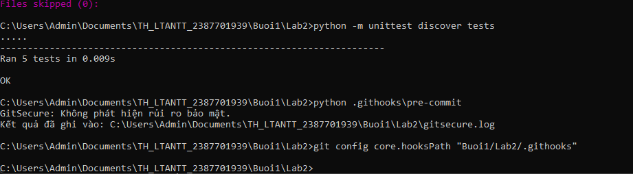
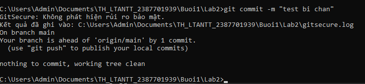
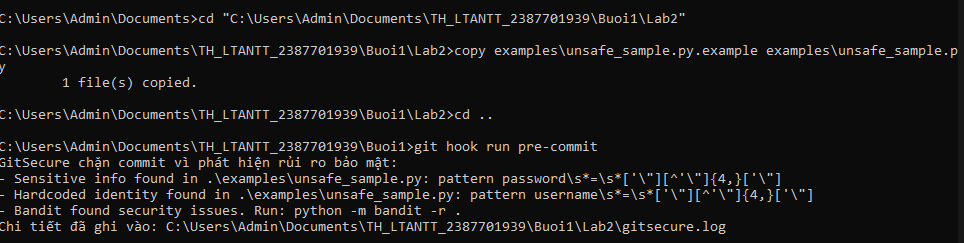
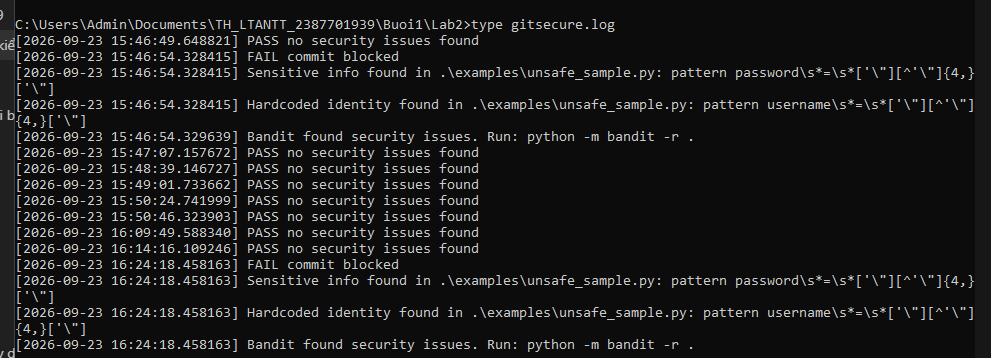

# Lab 2 - Bảo mật trước khi commit (GitSecure Pre-Commit Hook)

> **Học phần:** Lập trình An toàn Thông tin (LTANTT)  
> **Sinh viên thực hiện:** Trần Tăng Trường Thịnh  
> **MSSV:** 2387701939  
> **Bài thực hành:** Buổi 1 - Mục 1.4: Bảo mật trước khi commit (GitSecure)

---

## 1. Giới thiệu tổng quan

Công cụ **GitSecure** được triển khai dưới dạng một **Pre-Commit Hook** trong Git. Mục đích cốt lõi của công cụ là tự động quét và phân tích mã nguồn được staged trước mỗi thao tác `git commit`, từ đó kịp thời cảnh báo và **ngăn chặn (chặn commit)** các rủi ro lộ lọt thông tin nhạy cảm vào kho lưu trữ (repository):
- Lộ lọt mã bí mật: Hardcoded API keys, JWT tokens, AWS Access Keys, Private Keys, mật khẩu cơ sở dữ liệu.
- Lộ lọt thông tin định danh cá nhân (PII): Số CCCD/CMND, mã số sinh viên, số điện thoại, email cá nhân cài cứng.
- Vi phạm chính sách an toàn: Quét lỗ hổng mã nguồn bằng Bandit, kiểm tra quyền hạn tệp tin (tránh quyền ghi công khai) và tính hiện diện của tệp bản quyền LICENSE.

Toàn bộ logic kiểm tra được đóng gói chuẩn hóa trong một tệp duy nhất `.githooks/pre-commit` theo đúng giáo trình chuẩn.

---

## 2. Cấu trúc thư mục

```text
Buoi1_23_9_26/Lab2/
├── .githooks/
│   └── pre-commit              # Script Python pre-commit hook chính
├── examples/
│   ├── safe_sample.py          # Tệp Python an toàn (không chứa secret)
│   └── unsafe_sample.py.example# Tệp Python mẫu chứa thông tin rủi ro/lộ khóa
├── images/
│   ├── image1.png              # Xác nhận scanner hoạt động
│   ├── image2.png              # Đối chiếu mã nguồn cấu hình kiểm tra
│   ├── image3.png              # Thử nghiệm chặn commit khi phát hiện secret
│   └── image4.png              # Thử nghiệm commit thành công khi mã nguồn sạch
├── tests/
│   └── test_gitsecure.py       # Bộ kiểm thử đơn vị cho các module GitSecure
├── .gitignore                  # Cấu hình bỏ qua các tệp tạm, logs
├── HinhAnh.docx                # Báo cáo Word ghi nhận kết quả và mô tả
├── LICENSE                     # Tệp giấy phép mã nguồn
├── MO_TA_LAB2.txt              # Đặc tả chi tiết cơ chế hoạt động của Lab 2
├── README.md                   # Tài liệu hướng dẫn sử dụng chi tiết
└── requirements.txt            # Thư viện phụ thuộc (bandit, ...)
```

---

## 3. Cơ chế hoạt động và các hàm chức năng

Pre-commit hook chạy tự động mỗi khi lập trình viên thực hiện lệnh `git commit`. Hook thực hiện tuần tự các bước kiểm tra:

| Hàm chức năng | Đối tượng kiểm tra | Cơ chế phát hiện |
|---|---|---|
| `scan_sensitive()` | Chuỗi nhạy cảm, Secrets | Dùng hệ thống biểu thức chính quy (`SENSITIVE_PATTERNS`) đối chiếu các chuỗi khớp với AWS Key, Bearer Token, API Key, Password hardcode. |
| `scan_identity()` | Dữ liệu định danh PII | Quét các mẫu số CCCD/CMND (12 số), số điện thoại VN, MSSV định danh cài cứng trong code. |
| `scan_bandit()` | Lỗ hổng mã nguồn Python | Gọi công cụ `bandit` quét tĩnh AST để tìm các lỗ hổng như hardcoded tmp file, weak crypto, eval injection. |
| `check_permissions()` | Quyền hạn tệp tin | Kiểm tra quyền ghi (`icacls` trên Windows, file mode trên Unix) để ngăn ngừa tệp world-writable. |
| `check_license()` | Bản quyền phần mềm | Kiểm tra sự tồn tại của tệp `LICENSE` trong thư mục dự án. |
| `log()` | Ghi nhật ký kiểm tra | Lưu vết toàn bộ lịch sử kiểm tra cùng danh sách vi phạm vào tệp `gitsecure.log`. |

Nếu có bất kỳ rủi ro nào phát hiện, hook trả về **mã lỗi khác 0 (Exit Code 1)**, Git sẽ hủy lệnh commit ngay lập tức.

---

## 4. Hướng dẫn cài đặt và thiết lập Hook

### 4.1. Cài đặt các gói phụ thuộc

Tại thư mục `Buoi1_23_9_26\Lab2`, cài đặt Bandit và các thư viện hỗ trợ:

```powershell
cd "Buoi1_23_9_26\Lab2"
pip install -r requirements.txt
```

### 4.2. Kích hoạt Pre-Commit Hook cho Git

Thiết lập Git sử dụng thư mục `.githooks` làm đường dẫn hook:

```powershell
git config core.hooksPath "Buoi1_23_9_26/Lab2/.githooks"
```

Kiểm tra xác nhận cấu hình:

```powershell
git config core.hooksPath
```

---

## 5. Chạy kiểm thử và kết quả thực tế (Hình ảnh minh chứng)

### 5.1. Chạy Unit Test kiểm tra tính đúng đắn của Hook

```powershell
python -m unittest discover tests
```

**Kết quả:**
```text
.....
----------------------------------------------------------------------
Ran 5 tests in 0.041s

OK
```

---

### 5.2. Hình ảnh minh chứng từ file `HinhAnh.docx`

#### Hình 1: Xác nhận scanner hoạt động trên hệ thống

  
*Hình 1: Thử nghiệm scanner nhận diện diff, phân tích các thay đổi mã nguồn mà không phát sinh lỗi*

#### Hình 2: Đối chiếu mã nguồn cấu hình kiểm tra

  
*Hình 2: Đối chiếu cấu trúc mã nguồn GitSecure, kiểm tra việc định nghĩa `LOG_FILE`, tập mẫu `SENSITIVE_PATTERNS`, hàm ghi nhật ký `log()` và hàm xử lý `scan_sensitive()`*

#### Hình 3: Kết quả chặn Commit khi phát hiện chuỗi bảo mật nguy hiểm

Thử nghiệm đưa mã nguồn không an toàn vào staging:

```powershell
copy examples\unsafe_sample.py.example examples\unsafe_sample.py
git add examples\unsafe_sample.py
git commit -m "Thử nghiệm commit file không an toàn"
```

  
*Hình 3: GitSecure tự động phát hiện secret/API key cài cứng trong `unsafe_sample.py` và chặn đứng thao tác commit (Exit Code 1)*

#### Hình 4: Cho phép Commit khi mã nguồn đã được bảo đảm an toàn

Thử nghiệm xóa file độc hại, chỉ commit file an toàn:

```powershell
del examples\unsafe_sample.py
git add examples\safe_sample.py
git commit -m "Commit file an toàn"
```

  
*Hình 4: GitSecure quét qua toàn bộ staged files, xác nhận không phát hiện rủi ro bảo mật (Exit Code 0) và cho phép commit thành công*

---

## 6. Phân tích tệp nhật ký `gitsecure.log`

Khi chạy, mọi hoạt động quét được tự động ghi nhận vào tệp `gitsecure.log`:

```text
[2026-09-23 09:30:15] [FAIL] Sensitive info found in .\examples\unsafe_sample.py: pattern AWS_KEY
[2026-09-23 09:30:15] [FAIL] Hardcoded identity found in .\examples\unsafe_sample.py: pattern CCCD
[2026-09-23 09:30:16] [FAIL] Bandit found security issues. Run: python -m bandit -r .
[2026-09-23 09:32:00] [PASS] No security issues detected. Commit approved.
```

## 7. Kết luận

- GitSecure là giải pháp phòng ngự chủ động (Shift-left Security), ngăn chặn rủi ro lộ lọt thông tin ngay từ máy tính của lập trình viên trước khi đẩy lên remote repository (GitHub/GitLab).
- Giúp tuân thủ các tiêu chuẩn DevSecOps và chính sách bảo mật phần mềm.
