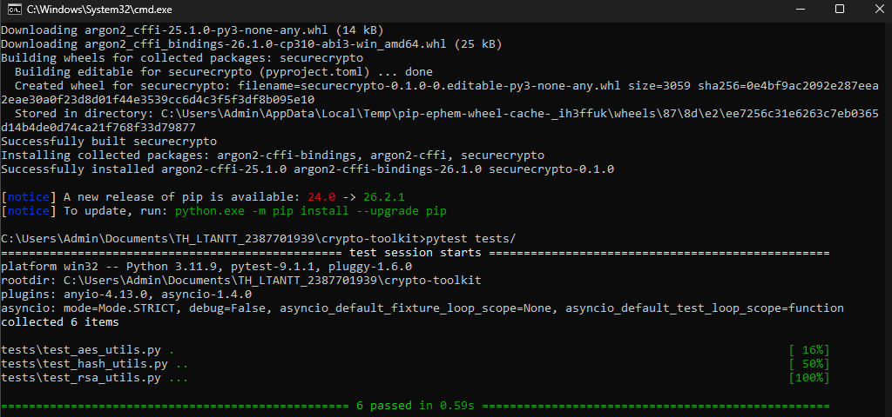
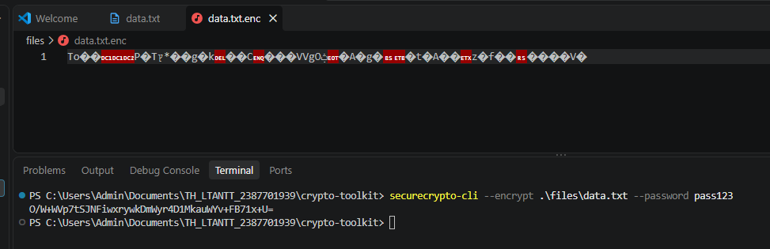
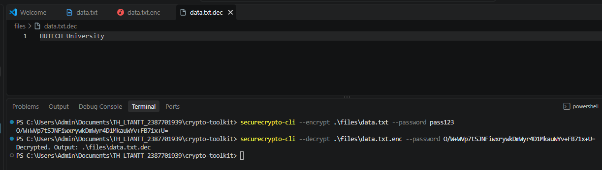
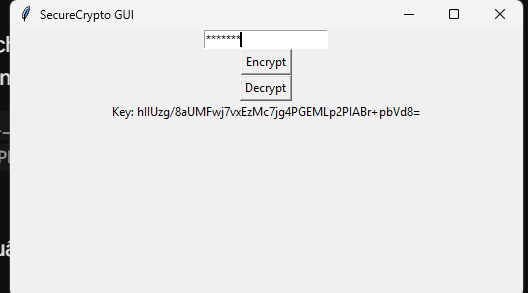
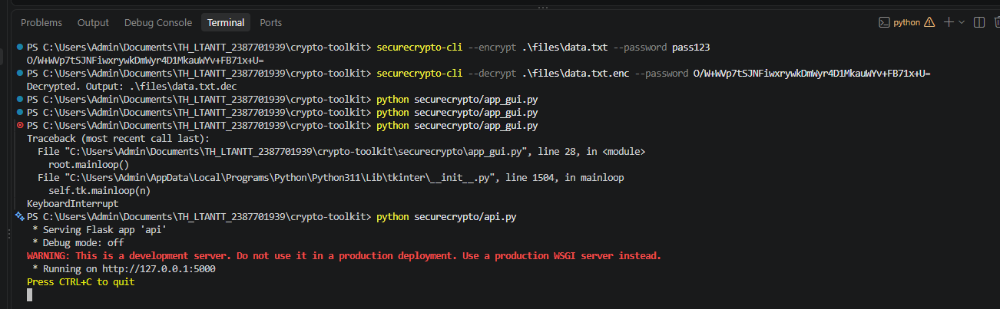
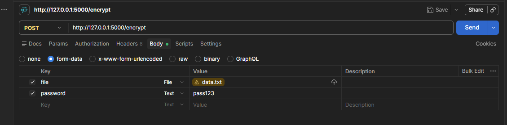
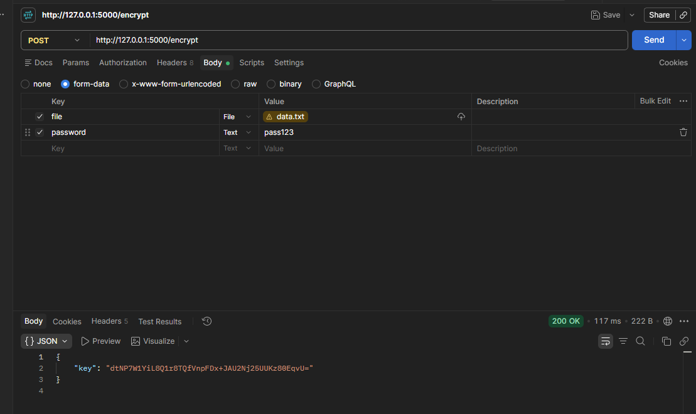
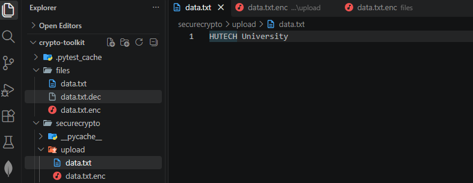
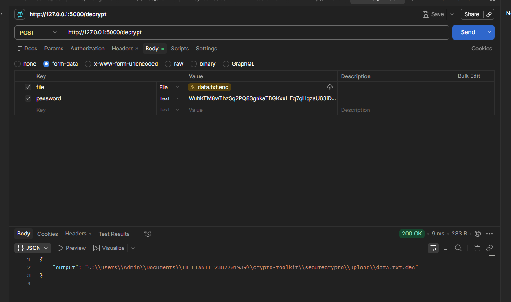

# BÁO CÁO THỰC HÀNH BUỔI 2: MẬT MÃ ỨNG DỤNG VÀ HẠ TẦNG KHÓA CÔNG KHAI (PKI)

> **Học phần:** Lập trình An toàn Thông tin (LTANTT)  
> **Sinh viên thực hiện:** Trần Tăng Trường Thịnh  
> **MSSV:** 2387701939  
> **Ngày thực hiện:** 30/09/2026  

---

## 📑 Mục lục nội dung

1. [Tổng quan nội dung thực hành](#1-tổng-quan-nội-dung-thực-hành)
2. [Phần 1: SecureCrypto Toolkit (Mục 2.2)](#2-phần-1-securecrypto-toolkit)
   - [2.1. Kiến trúc và công nghệ](#21-kiến-trúc-và-công-nghệ)
   - [2.2. Kiểm thử tự động với Pytest (Hình 1)](#22-kiểm-thử-tự-động-với-pytest)
   - [2.3. Mã hóa và giải mã file qua CLI (Hình 2 - Hình 3)](#23-mã-hóa-và-giải-mã-file-qua-cli)
   - [2.4. Giao diện đồ họa SecureCrypto GUI (Hình 4)](#24-giao-diện-đồ-họa-securecrypto-gui)
   - [2.5. Kiểm thử Flask REST API với Postman (Hình 5 - Hình 8)](#25-kiểm-thử-flask-rest-api-với-postman)
3. [Phần 2: Certificate Authority - Mini CA (Mục 2.4)](#3-phần-2-certificate-authority---mini-ca)
   - [3.1. Mô hình PKI 2 cấp](#31-mô-hình-pki-2-cấp)
   - [3.2. Chạy tự động qua dòng lệnh demo.py (Hình 9 - Hình 10)](#32-chạy-tự-động-qua-dòng-lệnh-demopy)
   - [3.3. Mô phỏng trực quan trên Tkinter GUI (Hình 11 - Hình 16)](#33-mô-phỏng-trực-quan-trên-tkinter-gui)
4. [Tổng kết và bài học kinh nghiệm](#4-tổng-kết-và-bài-học-kinh-nghiệm)

---

## 1. Tổng quan nội dung thực hành

Buổi thực hành số 2 tập trung vào hai mảng kiến thức trọng tâm của mật mã học ứng dụng:
1. **Mã hóa dữ liệu an toàn:** Triển khai thuật toán mã hóa đối xứng xác thực **AES-GCM** kết hợp hàm dẫn xuất khóa hiện đại **Argon2**, hỗ trợ bảo vệ dữ liệu ở trạng thái nghỉ (Data at Rest).
2. **Hạ tầng khóa công khai (PKI):** Xây dựng hệ thống nhà thẩm quyền chứng chỉ số **Mini CA** chuẩn **X.509 v3** sử dụng thuật toán khóa bất đối xứng **RSA 2048-bit**, quản lý toàn bộ vòng đời chứng chỉ số và thu hồi khóa bị thỏa hiệp qua danh sách CRL.

---

## 2. Phần 1: SecureCrypto Toolkit

### 2.1. Kiến trúc và công nghệ

- **Thuật toán cốt lõi:** AES-256-GCM (khóa 256-bit, nonce 96-bit, Auth Tag 128-bit chống giả mạo ciphertext).
- **Hàm dẫn xuất khóa:** Argon2id (bảo vệ chống brute-force và phần cứng ASIC chuyên dụng).
- **Giao diện đa dạng:** Dòng lệnh (CLI), Giao diện đồ họa (Tkinter), và Dịch vụ Web API (Flask REST API).

---

### 2.2. Kiểm thử tự động với Pytest

Chạy lệnh kiểm thử đơn vị cho toàn bộ thư viện:

```powershell
cd "Buoi2_30_9_26\crypto-toolkit"
$env:PYTHONPATH="." ; pytest
```

  
*Hình 1: Chạy Unit Tests với Pytest thành công 6/6 test cases (AES, Hash, RSA)*

---

### 2.3. Mã hóa và giải mã file qua CLI

Thực thi mã hóa tệp tin văn bản `files/data.txt`:

```powershell
python securecrypto/cli.py --encrypt files/data.txt --password MySecretPassword123
```

  
*Hình 2: Kết quả thực thi mã hóa tệp tin qua giao diện dòng lệnh CLI*

Thực thi giải mã tệp tin `files/data.txt.enc` với khóa Base64 tương ứng:

```powershell
python securecrypto/cli.py --decrypt files/data.txt.enc --password <base64_key>
```

  
*Hình 3: Giải mã file bằng CLI thành công khôi phục file data.txt.dec*

---

### 2.4. Giao diện đồ họa SecureCrypto GUI

Khởi động giao diện Tkinter hỗ trợ người dùng thao tác trực quan:

```powershell
python securecrypto/app_gui.py
```

  
*Hình 4: Kết quả thực thi mã hóa file thành công trên giao diện SecureCrypto GUI*

---

### 2.5. Kiểm thử Flask REST API với Postman

Khởi động máy chủ Flask API lắng nghe tại cổng `http://127.0.0.1:5000`:

```powershell
python securecrypto/api.py
```

  
*Hình 5: Khởi động máy chủ Flask API*

Sử dụng Postman gửi yêu cầu `POST /encrypt` kèm tệp tin và mật khẩu:

  
*Hình 6: Kiểm tra API encrypt bằng Postman*

Server xử lý mã hóa, trả về chuỗi khóa Base64 và lưu trữ tệp `.enc` vào thư mục lưu trữ:

  
*Hình 7.1: Bấm Send ta thu được khóa Base64 phản hồi từ API*

  
*Hình 7.2: Tệp gốc và tệp mã hóa được lưu trong thư mục `securecrypto/upload`*

Gửi yêu cầu giải mã `POST /decrypt` kèm tệp `.enc` và chuỗi khóa Base64:

  
*Hình 8: Giải mã file thông qua Flask API (Postman) kèm đường dẫn tệp tin giải mã thành công*

---

## 3. Phần 2: Certificate Authority - Mini CA

### 3.1. Mô hình PKI 2 cấp

Hệ thống thẩm quyền chứng chỉ số được xây dựng theo mô hình phân cấp:
- **Root CA:** Gốc rễ của chuỗi tin cậy, tự ký chứng chỉ số của chính mình.
- **Intermediate CA:** Được Root CA ký xác nhận, có nhiệm vụ ký phát hành chứng chỉ cho người dùng và quản lý danh sách thu hồi.
- **End-Entity:** Người dùng cuối hoặc máy chủ nhận chứng chỉ số phục vụ mã hóa và định danh.

---

### 3.2. Chạy tự động qua dòng lệnh `demo.py`

Thực thi kịch bản CLI kiểm thử toàn bộ chu trình chứng chỉ số:

```powershell
cd "Buoi2_30_9_26\mini-ca"
python demo.py
```

  
*Hình 9: Chạy file “demo.py” và kiểm tra kết quả khởi tạo, xác minh và thu hồi chứng chỉ*

Các tệp tin chứng chỉ và khóa RSA được tạo ra trong thư mục `certs/`:

  
*Hình 10: Các file .pem trong folder “mini-ca/certs”*

---

### 3.3. Mô phỏng trực quan trên Tkinter GUI (`demo_ui.py`)

Khởi động giao diện người dùng:

```powershell
python demo_ui.py
```

  
*Hình 11: Giao diện khi chạy file demo_ui.py*

Quy trình thực hiện từng bước trên giao diện:

| Thao tác | Hình ảnh minh chứng | Giải thích kỹ thuật |
|---|---|---|
| **Khởi tạo CA** | <br>*Hình 12* | **Khởi tạo thành công Root CA và Intermediate CA:** Tạo 2 cặp khóa RSA 2048-bit, tự ký Root cert và dùng Root ký Intermediate cert. |
| **Phát hành Cert** | <br>*Hình 13* | **Phát hành chứng chỉ số cho người dùng cuối (End-Entity):** Sinh chứng chỉ X.509 với đầy đủ Subject, Serial Number và thời hạn hiệu lực. |
| **Xác minh chuỗi** | <br>*Hình 14* | **Xác minh tính hợp lệ của chuỗi chứng chỉ từ User lên Root CA:** Kiểm tra chữ ký số ngược chuỗi thành công, xác nhận nguồn gốc tin cậy. |
| **Thu hồi chứng chỉ** | <br>*Hình 15* | **Đưa chứng chỉ người dùng vào danh sách thu hồi với lý do lộ khóa:** Cập nhật Serial Number vào CRL kèm lý do `key_compromise`. |
| **Kiểm tra trạng thái** | <br>*Hình 16* | **Kiểm tra trạng thái thu hồi của chứng chỉ (OCSP / CRL Check):** Hệ thống thông báo chứng chỉ đã bị thu hồi và không còn giá trị sử dụng. |

---

## 4. Tổng kết và bài học kinh nghiệm

1. **Hiệu năng và an toàn của AES-GCM:** Cung cấp tốc độ cao và khả năng phát hiện sửa đổi bản tin ngay tức thì nhờ Authentication Tag.
2. **Quy trình PKI chuẩn mực:** Hiểu rõ tầm quan trọng của phân cấp thẩm quyền (Root CA ngoại tuyến, Intermediate CA hoạt động trực tuyến) và quy trình xử lý khẩn cấp khi khóa bí mật bị thỏa hiệp thông qua CRL/OCSP.
