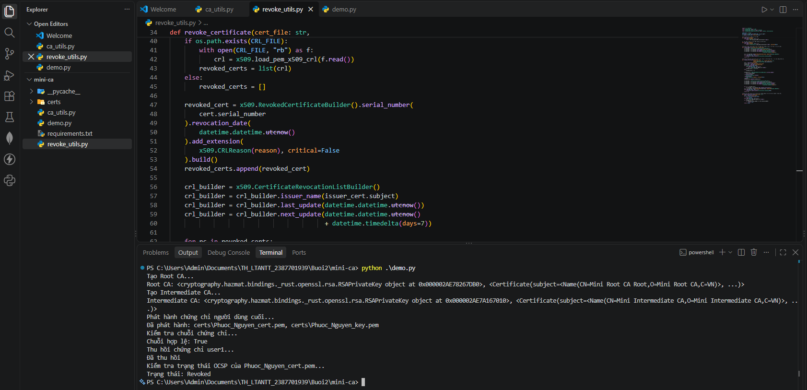
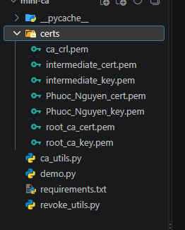
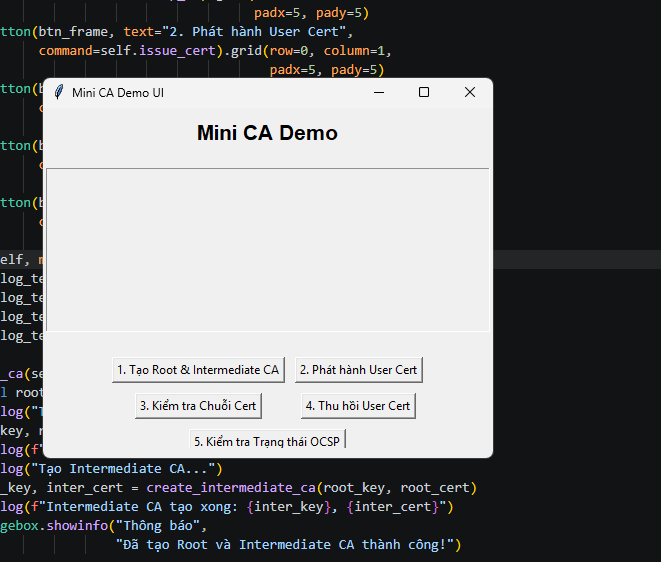
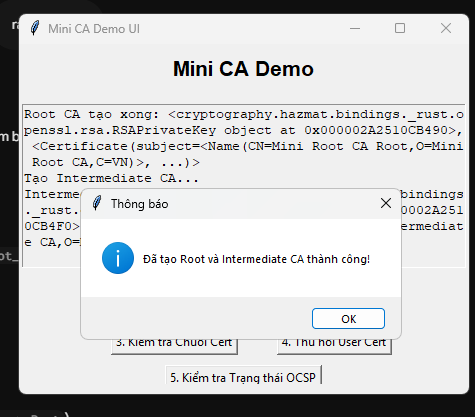
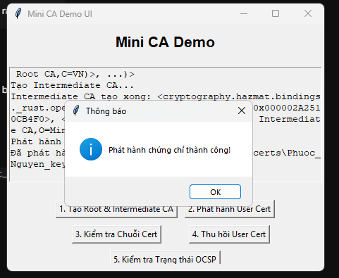
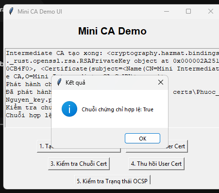
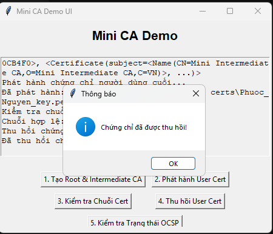
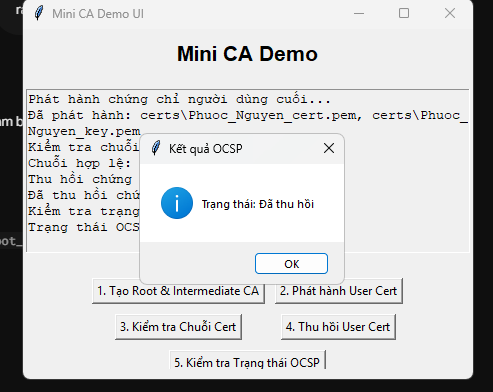

# Mini CA - Mô phỏng hệ thống thẩm quyền chứng chỉ số (PKI)

> **Học phần:** Lập trình An toàn Thông tin (LTANTT)  
> **Sinh viên thực hiện:** Trần Tăng Trường Thịnh  
> **MSSV:** 2387701939  
> **Bài thực hành:** Buổi 2 - Mục 2.4: Thực hành Certificate Authority (Mini CA)

---

## 1. Giới thiệu tổng quan

Hạ tầng khóa công khai (Public Key Infrastructure - PKI) là nền tảng cốt lõi của an ninh mạng toàn cầu, bảo đảm tính xác thực, toàn vẹn và chống chối bỏ cho các giao thức mạng như HTTPS/TLS, SSH, VPN, và chữ ký số văn bản điện tử.

**Mini CA** là một mô hình PKI hoàn chỉnh 2 cấp (Two-tier CA Architecture) được xây dựng bằng Python sử dụng thư viện `cryptography`, triển khai đầy đủ các quy trình nghiệp vụ theo chuẩn **X.509 v3**:
1. **Root CA (Certificate Authority gốc):** Khởi tạo cặp khóa RSA 2048-bit và tự ký chứng chỉ số (Self-signed Certificate).
2. **Intermediate CA (CA trung gian):** Khởi tạo cặp khóa và được ký xác nhận bởi Root CA. Phân tách quyền hạn phát hành chứng chỉ trực tiếp.
3. **End-Entity Certificate (Chứng chỉ người dùng cuối):** Cấp phát chứng chỉ định danh người dùng (User/Server) được ký bởi Intermediate CA.
4. **Certificate Chain Verification (Xác minh chuỗi chứng chỉ):** Kiểm tra tính hợp lệ của toàn bộ chuỗi chứng thực từ End-Entity -> Intermediate CA -> Root CA.
5. **Certificate Revocation (Thu hồi chứng chỉ):** Tạo danh sách thu hồi chứng chỉ (CRL - Certificate Revocation List) đối với chứng chỉ bị lộ khóa (`key_compromise`).
6. **OCSP / CRL Status Check:** Kiểm tra trạng thái hiệu lực theo thời gian thực của chứng chỉ số.

---

## 2. Cấu trúc thư mục

```text
Buoi2_30_9_26/mini-ca/
├── ca_utils.py                # Hàm sinh khóa RSA, cấp chứng chỉ và xác minh chuỗi
├── revoke_utils.py            # Hàm tạo danh sách CRL, thu hồi chứng chỉ và kiểm tra trạng thái
├── demo.py                    # Script tự động thực hiện toàn bộ luồng CA qua dòng lệnh
├── demo_ui.py                 # Ứng dụng giao diện đồ họa Tkinter mô phỏng trực quan
├── requirements.txt           # Thư viện phụ thuộc (cryptography)
├── certs/                     # Thư mục lưu trữ khóa riêng .key và chứng chỉ .pem
├── images/
│   ├── image10.png            # Hình 9: Thực thi demo.py và kết quả dòng lệnh
│   ├── image11.png            # Hình 10: Các tệp .pem trong thư mục certs/
│   ├── image12.png            # Hình 11: Khởi động giao diện demo_ui.py
│   ├── image13.png            # Hình 12: Khởi tạo thành công Root CA và Intermediate CA
│   ├── image14.png            # Hình 13: Phát hành chứng chỉ cho End-Entity
│   ├── image15.png            # Hình 14: Xác minh tính hợp lệ của chuỗi chứng chỉ
│   ├── image16.png            # Hình 15: Thu hồi chứng chỉ với lý do key_compromise
│   └── image17.png            # Hình 16: Kiểm tra trạng thái thu hồi (CRL Check)
└── README.md                  # Tài liệu hướng dẫn sử dụng (file này)
```

---

## 3. Cài đặt môi trường

Mở PowerShell tại thư mục `mini-ca`:

```powershell
cd "Buoi2_30_9_26\mini-ca"
pip install -r requirements.txt
```

---

## 4. Thực thi và kết quả kiểm thử (Hình ảnh minh chứng)

### 4.1. Chạy demo tự động qua dòng lệnh (`demo.py`)

Thực thi kịch bản kiểm thử toàn diện:

```powershell
python demo.py
```

  
*Hình 9: Chạy file "demo.py" và kiểm tra kết quả khởi tạo, xác minh chuỗi và thu hồi chứng chỉ thành công trên Terminal*

#### Kiểm tra các tệp tin chứng chỉ sinh ra:

Sau khi chạy, toàn bộ khóa và chứng chỉ số X.509 được lưu trữ dạng `.pem` trong thư mục `certs/`:
- `root_key.pem`, `root_cert.pem`: Khóa riêng và chứng chỉ tự ký của Root CA.
- `inter_key.pem`, `inter_cert.pem`: Khóa riêng và chứng chỉ được ký bởi Root CA của Intermediate CA.
- `user_key.pem`, `user_cert.pem`: Khóa riêng và chứng chỉ cấp phát cho người dùng.
- `crl.pem`: Danh sách thu hồi chứng chỉ.

  
*Hình 10: Các file .pem trong folder "mini-ca/certs" sau khi hệ thống khởi tạo thành công*

---

### 4.2. Chạy mô phỏng trên giao diện trực quan (`demo_ui.py`)

Khởi chạy ứng dụng đồ họa:

```powershell
python demo_ui.py
```

  
*Hình 11: Giao diện trực quan của Mini CA Demo UI khi vừa khởi động*

Ứng dụng cung cấp 5 chức năng theo trình tự mô phỏng thực tế:

#### Bước 1: Khởi tạo Root CA và Intermediate CA
Nhấp nút **Tạo Root CA & Intermediate CA**:
Hệ sinh cặp khóa RSA 2048-bit, tự ký chứng chỉ Root CA, sau đó sinh cặp khóa Intermediate và phát hành chứng chỉ cấp 2 được ký bởi khóa riêng của Root CA.

  
*Hình 12: Thông báo khởi tạo thành công Root CA và Intermediate CA*

#### Bước 2: Phát hành chứng chỉ người dùng cuối (End-Entity)
Nhấp nút **Phát hành User Cert**:
Tạo yêu cầu chứng chỉ cho thực thể cuối `CN=User`, Intermediate CA dùng khóa bí mật của mình để ký phát hành chứng chỉ số có giá trị thời hạn theo chuẩn X.509.

  
*Hình 13: Phát hành thành công chứng chỉ số cho người dùng cuối (End-Entity)*

#### Bước 3: Xác minh tính hợp lệ của chuỗi chứng chỉ (Chain Validation)
Nhấp nút **Kiểm tra Chuỗi Cert**:
Thuật toán kiểm tra chữ ký số ngược dòng: Khóa công khai của Root CA xác thực chữ ký của Intermediate CA; Khóa công khai của Intermediate CA xác thực chữ ký của User Cert.

  
*Hình 14: Xác minh tính hợp lệ của chuỗi chứng chỉ từ User lên Root CA thành công*

#### Bước 4: Thu hồi chứng chỉ người dùng (Revocation)
Nhấp nút **Thu hồi User Cert**:
Giả lập tình huống khóa riêng của người dùng bị rò rỉ (`Reason: key_compromise`). Intermediate CA cập nhật Serial Number của chứng chỉ vào danh sách thu hồi CRL và ký số danh sách này.

  
*Hình 15: Đưa chứng chỉ người dùng vào danh sách thu hồi với lý do lộ khóa (key_compromise)*

#### Bước 5: Kiểm tra trạng thái thu hồi (OCSP / CRL Check)
Nhấp nút **Kiểm tra trạng thái (OCSP/CRL)**:
Truy vấn danh sách CRL đã ký. Hệ thống phát hiện số Serial của chứng chỉ nằm trong danh sách đen và thông báo chứng chỉ đã mất hiệu lực.

  
*Hình 16: Kiểm tra trạng thái thu hồi của chứng chỉ (OCSP / CRL Check) xác nhận chứng chỉ đã bị vô hiệu hóa*

---

## 5. Kết luận

Mô hình Mini CA giúp nắm vững kiến thức thực tế về:
- Cấu trúc thứ bậc tin cậy (Hierarchical Trust Model) trong mạng máy tính.
- Chuẩn định dạng chứng chỉ X.509 v3 và thuật toán mã hóa khóa công khai RSA.
- Cơ chế quản lý vòng đời chứng chỉ số: Đăng ký, Cấp phát, Xác thực chuỗi tin cậy, và Thu hồi khi có sự cố lộ khóa.
