# BÁO CÁO THỰC HÀNH BUỔI 3: BẢO MẬT MẠNG MÁY TÍNH VÀ TRINH SÁT HỆ THỐNG

> **Học phần:** Lập trình An toàn Thông tin (LTANTT)  
> **Sinh viên thực hiện:** Trần Tăng Trường Thịnh  
> **MSSV:** 2387701939  
> **Ngày thực hiện:** 07/10/2026  

---

## 📑 Mục lục nội dung

1. [Tổng quan nội dung thực hành](#1-tổng-quan-nội-dung-thực-hành)
2. [Phần 1: 3.2 THỰC HÀNH: SECURECHAT (Hình 1 - Hình 4)](#2-phần-1-32-thực-hành-securechat)
   - [2.1. Thiết lập hạ tầng chứng chỉ số OpenSSL PKI](#21-thiết-lập-hạ-tầng-chứng-chỉ-số-openssl-pki)
   - [2.2. Vận hành phòng chat mã hóa SSL/TLS & AES-256](#22-vận-hành-phòng-chat-mã-hóa-ssltls--aes-256)
3. [Phần 2: 3.4 THỰC HÀNH: NETRECON (Hình 5 - Hình 12)](#3-phần-2-34-thực-hành-netrecon)
   - [3.1. Chuẩn bị môi trường và cấu hình SMTP Alert](#31-chuẩn-bị-môi-trường-và-cấu-hình-smtp-alert)
   - [3.2. Kiểm thử trinh sát qua dòng lệnh CLI](#32-kiểm-thử-trinh-sát-qua-dòng-lệnh-cli)
   - [3.3. Rà quét trực quan qua Web UI và nhận Email cảnh báo](#33-rà-quét-trực-quan-qua-web-ui-và-nhận-email-cảnh-báo)
4. [Tổng kết công nghệ](#4-tổng-kết-công-nghệ)

---

## 1. Tổng quan nội dung thực hành

Nội dung thực hành Buổi 3 tập trung vào hai mảng cốt lõi trong bảo mật mạng máy tính:
1. **Bảo mật kênh truyền thông (Network Communication Security):** Xây dựng hệ thống chat mạng đa luồng **SecureChat** áp dụng xác thực định danh hai chiều (Mutual TLS - mTLS) kết hợp thuật toán mã hóa đối xứng **AES-256** bảo vệ toàn vẹn và bí mật nội dung trao đổi.
2. **Trinh sát và đánh giá an toàn mạng (Network Reconnaissance & Vulnerability Assessment):** Phát triển bộ công cụ **NetRecon** tích hợp engine quét **Nmap**, socket bất đồng bộ (`asyncio`), quét dịch vụ, banner grabbing, đối soát mã CVE và gửi cảnh báo tự động qua giao thức SMTP.

---

## 2. Phần 1: 3.2 THỰC HÀNH: SECURECHAT

### 2.1. Thiết lập hạ tầng chứng chỉ số OpenSSL PKI

Hệ thống SecureChat đòi hỏi cả máy chủ và máy trạm đều sở hữu chứng chỉ X.509 hợp lệ được cấp bởi một CA chung:
- `openssl.cnf`: Định nghĩa cấu hình CA và Subject Alternative Name.
- `make-certs.bat`: Tự động khởi tạo Root CA (`ca.crt`), Server Certificate (`server.crt`) và Client Certificate (`client.crt`).

| Bước thực hiện | Hình ảnh minh chứng | Mô tả chi tiết |
|---|---|---|
| **Cấu hình OpenSSL** | 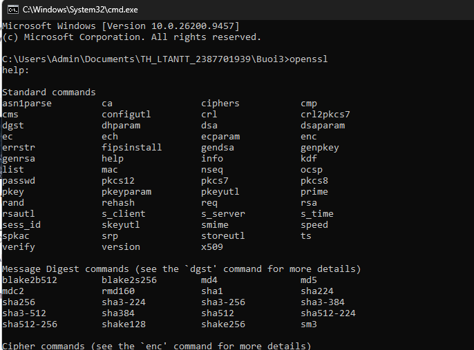 *Hình 1* | **Kiểm tra cấu hình Openssl:** Xem xét các tham số trong tệp `openssl.cnf` trước khi khởi tạo chứng chỉ. |
| **Sinh chứng chỉ** | 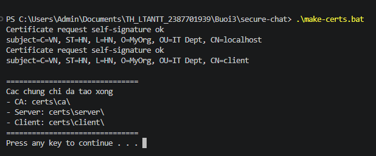 *Hình 2* | **Tạo thành công chứng chỉ CA, Server và Client bằng OpenSSL:** Chạy kịch bản batch tự động tạo các cặp khóa và chứng chỉ số. |
| **Kiểm tra thư mục** | 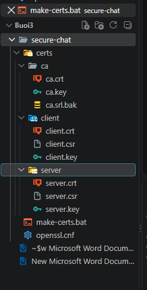 *Hình 3* | **Các thư mục và chứng chỉ đã được tạo:** Các khóa bí mật `.key` và chứng chỉ `.crt` được phân chia vào các thư mục `ca/`, `server/`, `client/`. |

---

### 2.2. Vận hành phòng chat mã hóa SSL/TLS & AES-256

- Khởi động máy chủ: `python server.py` (lắng nghe tại cổng `8443`).
- Khởi động các máy trạm: `python client.py` (thực hiện bắt tay TLS với server và yêu cầu xác thực 2 chiều).

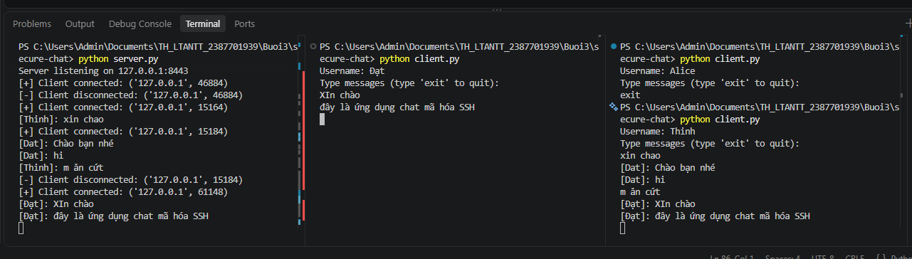  
*Hình 4: Chạy thành công SecureChat, các client kết nối đến server và trao đổi tin nhắn được mã hóa*

---

## 3. Phần 2: 3.4 THỰC HÀNH: NETRECON

### 3.1. Chuẩn bị môi trường và cấu hình SMTP Alert

NetRecon yêu cầu công cụ Nmap và thư viện Python để quét mạng, cùng cấu hình mật khẩu ứng dụng Google (App Password) để gửi email cảnh báo tự động:

| Bước chuẩn bị | Hình ảnh minh chứng | Mô tả chi tiết |
|---|---|---|
| **Kiểm tra Nmap** | 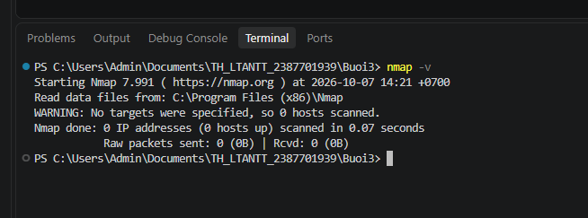 *Hình 5* | **Kiểm tra xem Nmap đã được cài đặt hay chưa trong Terminal:** Xác nhận phiên bản Nmap trên hệ thống. |
| **Lấy SMTP_PASS** | 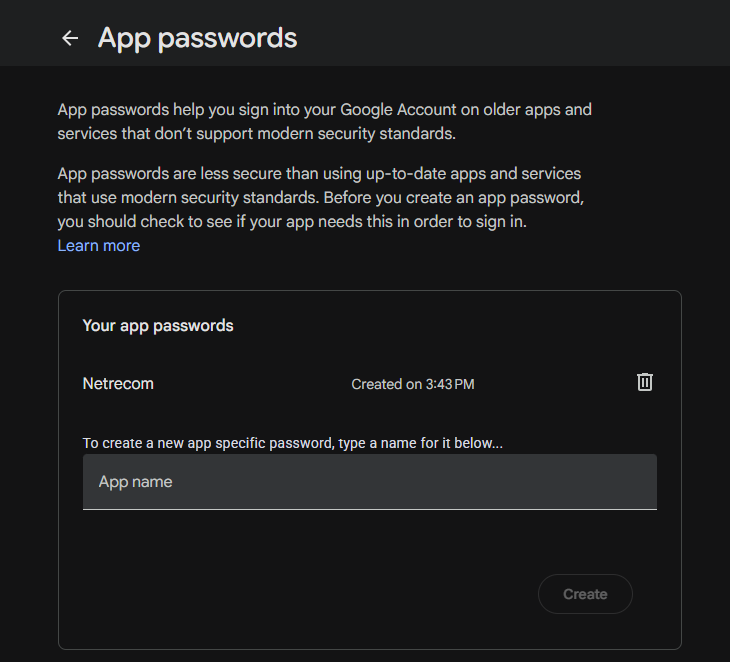 *Hình 6* | **Tạo app để lấy STMP_PASS:** Thiết lập mật khẩu ứng dụng Gmail để ứng dụng gửi email an toàn không cần mật khẩu chính. |
| **Cài đặt thư viện** | 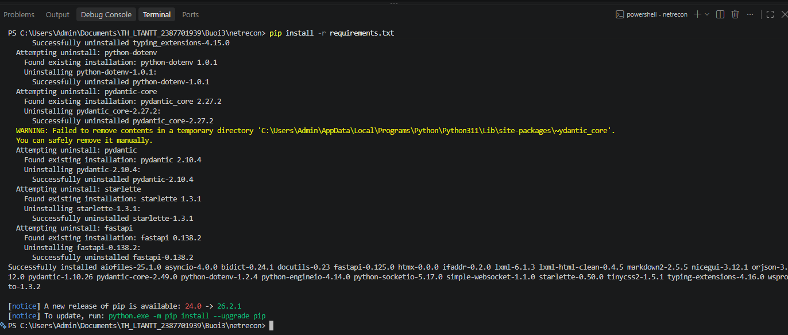 *Hình 7* | **Cài các gói cần thiết:** Thực thi lệnh `pip install -r requirements.txt`. |

---

### 3.2. Kiểm thử trinh sát qua dòng lệnh CLI

Kiểm tra tham số lệnh của công cụ CLI:

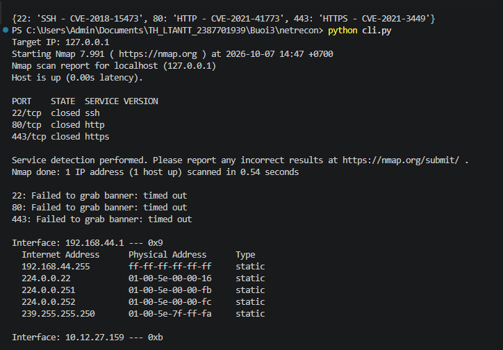  
*Hình 8: Chạy kiểm tra cli.py*

Chạy thử nghiệm quét nhanh mục tiêu trên dòng lệnh:

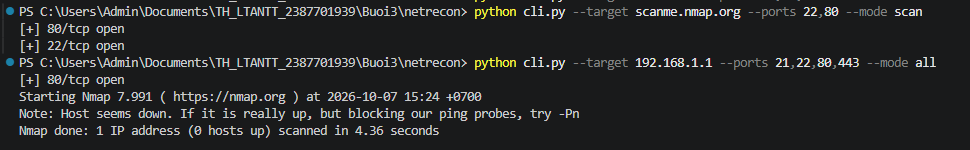  
*Hình 9: Test nhanh cli.py hiển thị các cổng mở và dịch vụ tương ứng*

---

### 3.3. Rà quét trực quan qua Web UI và nhận Email cảnh báo

Khởi động máy chủ Flask Web: `python app.py`

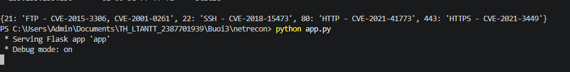  
*Hình 10: Kiểm tra app.py khởi động thành công trên cổng 5000*

Truy cập giao diện trang web tại `http://localhost:5000/`:

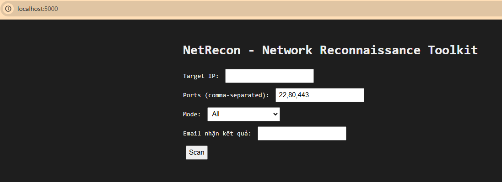  
*Hình 11.1: Giao diện trang web khi truy cập http://localhost:5000/*

Điền mục tiêu quét, danh sách cổng và địa chỉ nhận email, sau đó bấm **Scan**:

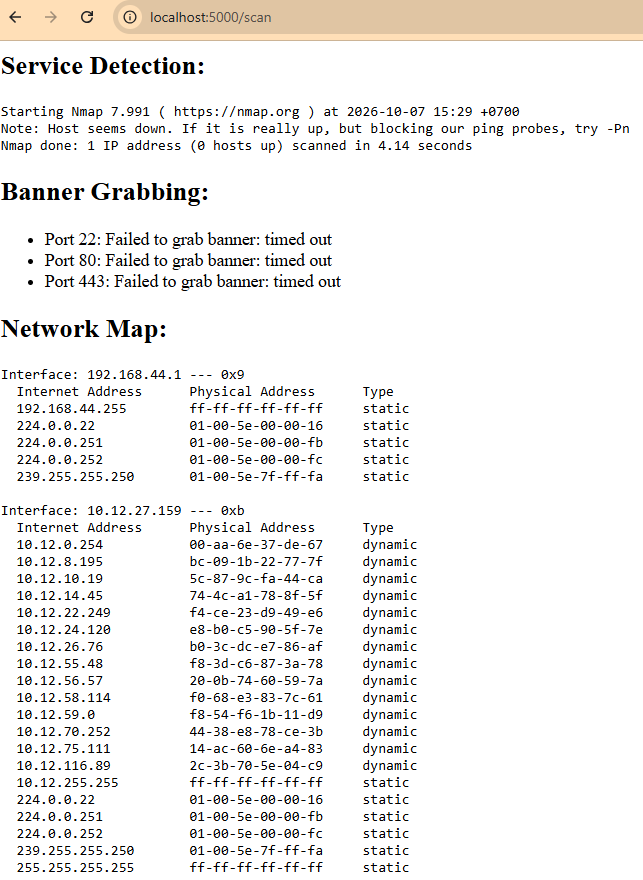  
*Hình 11.2: Phản hồi sau khi “Scan” - Bảng tổng hợp trạng thái các cổng, dịch vụ và banner*

Hệ thống lập tức tổng hợp kết quả và gửi email cảnh báo về hộp thư người dùng:

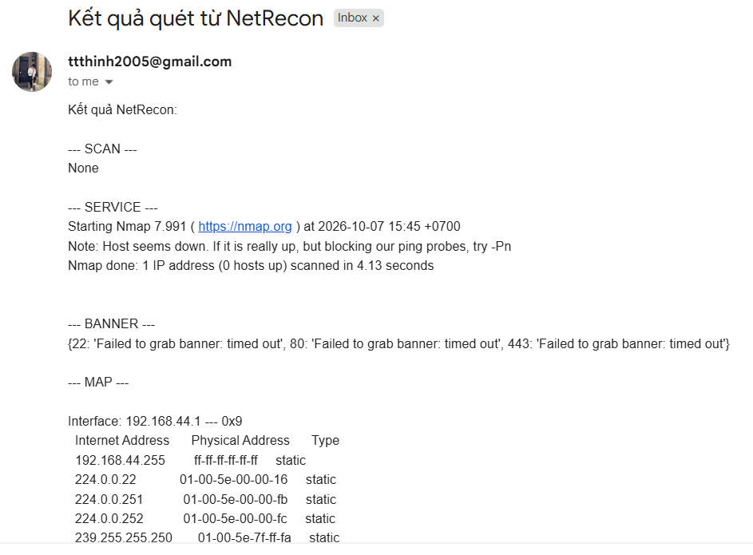  
*Hình 12: Email phản hồi từ hệ thống thông báo kết quả quét và các cảnh báo an ninh*

---

## 4. Tổng kết công nghệ

- **Ngăn chặn MitM hiệu quả:** SecureChat sử dụng cơ chế Mutual TLS loại bỏ hoàn toàn khả năng nghe lén và mạo danh máy chủ/máy trạm.
- **Tự động hóa an ninh mạng:** NetRecon giúp người quản trị nhanh chóng rà quét bề mặt tấn công, phát hiện sớm các dịch vụ lỗi thời hoặc mở cổng ngoài ý muốn và nhận thông báo cảnh báo tức thời.
