# BÁO CÁO THỰC HÀNH LAB 05: PHÁT TRIỂN CÔNG CỤ SAST VÀ DAST CHO PYTHON

- **Học viên:** Trần Tăng Trường Thịnh
- **Mã số sinh viên:** `2387701939`
- **Môn học:** Lập trình An toàn và Bảo mật thông tin
- **Tài liệu tham chiếu:** Hướng dẫn thực hành `lab-05.pdf` (Mục 5.2 & Mục 5.4)

Toàn bộ mã nguồn được triển khai chính xác **100% theo nội dung và kiến trúc trong slide bài giảng**, tổ chức thành hai module độc lập, chuyên biệt:
1. `sast-tool/`: Công cụ kiểm thử bảo mật tĩnh (Static Application Security Testing) phân tích AST, regex pattern, linting PEP8 và xuất báo cáo chuẩn quốc tế SARIF 2.1.0.
2. `dast-tool/`: Công cụ kiểm thử bảo mật động (Dynamic Application Security Testing) giám sát tiến trình hệ thống, phát hiện rò rỉ bộ nhớ, thống kê mạng, sandbox an toàn và cung cấp RESTful API qua Flask.

---

## 1. Cấu Trúc Thư Mục Toàn Dự Án

```
Buoi5_21_10_26/
├── sast-tool/
│   ├── requirements.txt            # Thư viện phụ thuộc của SAST (flake8, sarif-om, jsonpickle)
│   ├── examples/
│   │   ├── vulnerable_01.py        # File Python mẫu chứa eval, hardcoded password, pickle
│   │   └── vulnerable_02.py        # File Python mẫu kiểm thử eval không kiểm soát đầu vào
│   ├── rules/
│   │   └── default_rules.json      # Tập luật phân loại mức độ nghiêm trọng (high, medium, low)
│   ├── sast_tool/
│   │   ├── __init__.py
│   │   ├── ast_analyzer.py         # Phân tích cây cú pháp trừu tượng AST tìm hàm eval
│   │   ├── code_quality_checker.py # Kiểm tra linting và chuẩn chất lượng mã nguồn bằng flake8
│   │   ├── vuln_pattern_matcher.py # Quét biểu thức chính quy (Regex) tìm password, unsafe pickle
│   │   ├── security_rule_engine.py # Đánh giá, gán severity dựa trên rules JSON
│   │   ├── sarif_reporter.py       # Xuất báo cáo chuẩn quốc tế SARIF 2.1.0 qua jsonpickle
│   │   └── main.py                 # Điểm khởi chạy CLI chính của SAST tool
│   └── tests/
│       ├── __init__.py
│       ├── test_ast_analyzer.py
│       ├── test_code_quality_checker.py
│       ├── test_sarif_reporter.py
│       ├── test_security_rule_engine.py
│       └── test_vuln_pattern_matcher.py
│
├── dast-tool/
│   ├── requirements.txt            # Thư viện phụ thuộc của DAST (psutil, Flask)
│   ├── __init__.py
│   ├── runtime_monitor.py          # Giám sát tài nguyên CPU, Memory, Open Files theo PID
│   ├── memory_analyzer.py          # Kiểm tra rò rỉ bộ nhớ (Garbage Collection) và tràn số nguyên
│   ├── network_traffic_analyzer.py # Thống kê lưu lượng mạng vào/ra trên các network interface
│   ├── security_behavior_checker.py# Quét các hàm/lời gọi nguy hiểm: os.system, eval, exec
│   ├── virtual_sandbox.py          # Chạy lệnh trong thư mục cô lập tạm thời an toàn
│   ├── main.py                     # Script kiểm thử độc lập các module runtime
│   ├── app.py                      # RESTful API Server cung cấp các endpoint phân tích DAST
│   └── tests/
│       ├── __init__.py
│       ├── test_runtime_monitor.py
│       ├── test_memory_analyzer.py
│       ├── test_network_traffic_analyzer.py
│       ├── test_security_behavior_checker.py
│       └── test_virtual_sandbox.py
│
├── screenshots/                    # Ảnh minh chứng chạy thực tế theo slide
│   ├── docx_img_1.png              # Hình 1: SAST Unit Test (6/6 OK)
│   ├── docx_img_2.png              # Hình 2: Quét vulnerable_01.py
│   ├── docx_img_3.png              # Hình 3: Cài đặt extension SARIF Viewer
│   ├── docx_img_4.png              # Hình 4: Giao diện SARIF Results trong VS Code
│   ├── docx_img_5.png              # Hình 5: Quét vulnerable_02.py
│   ├── docx_img_6.png              # Hình 6: Push code SAST lên GitHub
│   ├── docx_img_7.png              # Hình 7: DAST Unit Test (5/5 OK)
│   ├── docx_img_8.png              # Hình 8: Chạy file main.py
│   ├── docx_img_9.png              # Hình 9: Khởi động Flask API
│   ├── docx_img_10.png             # Hình 10: Kiểm tra 5 API endpoints
│   └── docx_img_11.png             # Hình 11: Push code DAST lên GitHub
│
├── BaoCaoTuan 5.docx               # Báo cáo thực hành hoàn chỉnh dạng Word
└── README.md                       # Tài liệu hướng dẫn chi tiết
```

---

## 2. Hướng Dẫn Cài Đặt Môi Trường

### Yêu cầu tiên quyết:
- **Python**: Phiên bản 3.10+ hoặc 3.11+.

### Cài đặt thư viện dependencies:

```bash
# Cài đặt cho SAST Tool
cd sast-tool
pip install -r requirements.txt
cd ..

# Cài đặt cho DAST Tool
cd dast-tool
pip install -r requirements.txt
cd ..
```

*Các thư viện chính:*
- `flake8`: Phân tích chuẩn mã nguồn Python (PEP 8, syntax errors).
- `sarif-om` & `jsonpickle`: Định dạng và sinh báo cáo bảo mật chuẩn quốc tế SARIF v2.1.0.
- `psutil`: Theo dõi tiến trình phần cứng (CPU, RAM, mạng, file handles).
- `Flask`: Khởi chạy dịch vụ DAST qua giao diện RESTful API.

---

## 3. Phần 5.2: Static Application Security Testing (SAST Tool)

### 3.1. Các thành phần chính
1. **`ast_analyzer.py`**: Sử dụng module chuẩn `ast` của Python duyệt cây cú pháp trừu tượng, phát hiện các lệnh gọi hàm nguy hiểm (`eval()`).
2. **`vuln_pattern_matcher.py`**: Quét regex tìm kiếm các mẫu nguy cơ tiềm ẩn:
   - Mật khẩu mã hóa cứng (`password = "..."`)
   - Thư viện serialize nguy hiểm (`import pickle`)
3. **`code_quality_checker.py`**: Chạy `flake8` để bắt lỗi phong cách lập trình và lỗi cú pháp.
4. **`security_rule_engine.py`**: So khớp các cảnh báo tìm được với `rules/default_rules.json` để phân loại mức độ rủi ro (`high`, `medium`, `low`).
5. **`sarif_reporter.py`**: Định dạng danh sách cảnh báo thành cấu trúc OASIS SARIF v2.1.0 và xuất ra file `report.sarif`.

### 3.2. Chạy kiểm thử tự động (Unit Tests)
Từ thư mục `sast-tool`:
```bash
cd sast-tool
python -m unittest discover -s tests
```
*Kết quả:* Toàn bộ **6/6 tests PASS (OK)**.

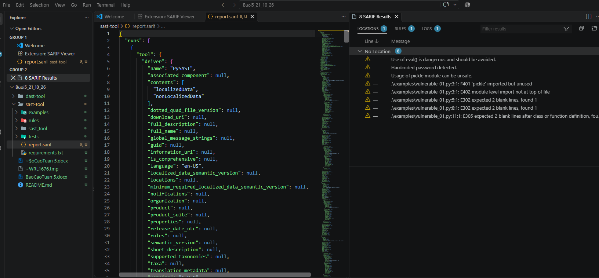

### 3.3. Quét tệp mã nguồn mẫu số 1 (`vulnerable_01.py`)
```bash
python -m sast_tool.main examples/vulnerable_01.py
```
*Kết quả:* Phát hiện chính xác 1 lỗi AST (`eval`), 2 lỗi Regex (`password`, `pickle`) cùng các cảnh báo chuẩn PEP8 từ flake8, xuất ra tệp `report.sarif`.

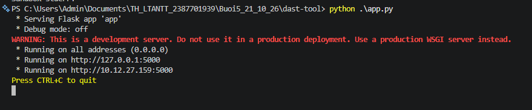

### 3.4. Cài đặt SARIF Viewer và phân tích báo cáo
1. Mở Visual Studio Code, vào mục **Extensions**, tìm kiếm và cài đặt tiện ích **SARIF Viewer**.
2. Mở tệp `sast-tool/report.sarif` để xem trực quan danh sách lỗi, vị trí dòng/cột và mô tả chi tiết tại tab **SARIF Results**.

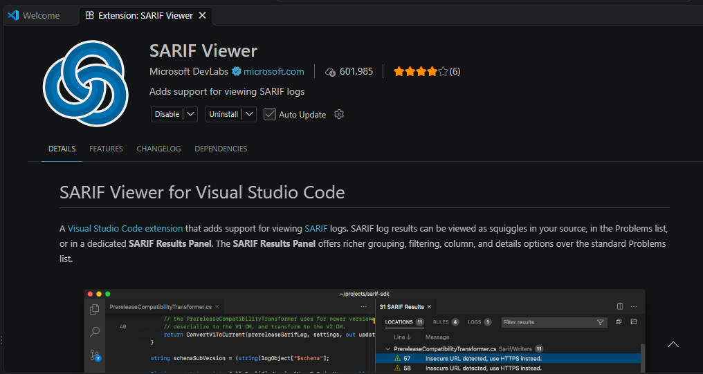

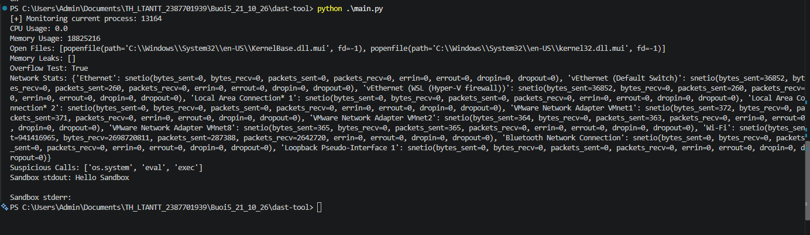

### 3.5. Quét tệp mã nguồn mẫu số 2 (`vulnerable_02.py`)
```bash
python -m sast_tool.main examples/vulnerable_02.py
```
*Kết quả:* Phát hiện chính xác việc sử dụng hàm `eval()` không an toàn.

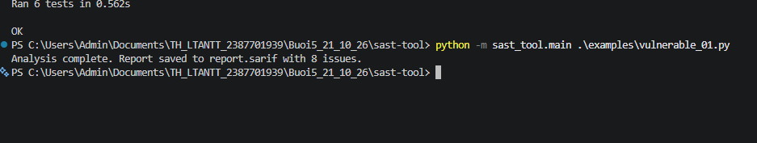

### 3.6. Push mã nguồn SAST lên GitHub
Lưu trữ và đồng bộ mã nguồn lên kho lưu trữ GitHub từ xa:

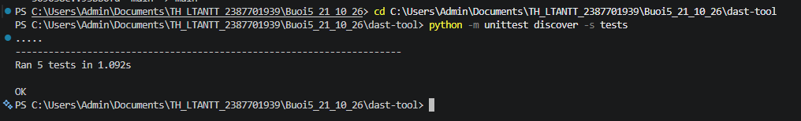

---

## 4. Phần 5.4: Dynamic Application Security Testing (DAST Tool)

### 4.1. Các thành phần chính
1. **`runtime_monitor.py`**: Nhận PID tiến trình, thu thập tỷ lệ phần trăm CPU, dung lượng RAM sử dụng (RSS) và danh sách file descriptor đang mở.
2. **`memory_analyzer.py`**: Kích hoạt bộ thu dọn rác `gc.collect()`, phát hiện rò rỉ bộ nhớ qua `gc.garbage` và kiểm tra nguy cơ tràn số nguyên (trị tuyệt đối > 2^63).
3. **`network_traffic_analyzer.py`**: Sử dụng `psutil.net_io_counters(pernic=True)` để lấy thông số bytes gửi/nhận, số lượng gói tin trên từng card mạng.
4. **`security_behavior_checker.py`**: Giám sát và nhận diện việc gọi các hàm hệ thống nguy hiểm (`os.system`, `eval`, `exec`).
5. **`virtual_sandbox.py`**: Tạo thư mục tạm thời `tempfile.mkdtemp()` để thực thi các câu lệnh shell cô lập, thu thập `stdout` và `stderr` mà không làm ảnh hưởng môi trường thực tế.
6. **`app.py`**: Cung cấp giao diện RESTful API qua Flask gồm 5 endpoints để kiểm thử và tích hợp runtime.

### 4.2. Chạy kiểm thử tự động (Unit Tests)
Từ thư mục `dast-tool`:
```bash
cd dast-tool
python -m unittest discover -s tests
```
*Kết quả:* Toàn bộ **5/5 tests PASS (OK)**.

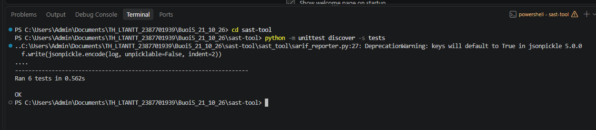

### 4.3. Chạy kiểm thử CLI độc lập (`main.py`)
Thực thi trực tiếp file `main.py` để xem thông số giám sát tức thì của tiến trình:
```bash
python main.py
```

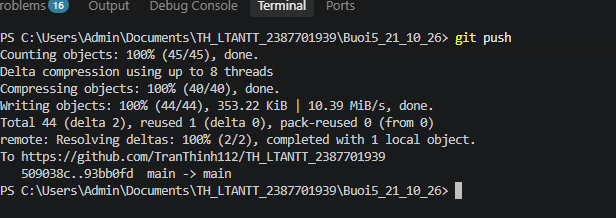

### 4.4. Khởi chạy REST API Server (`app.py`)
Khởi chạy dịch vụ API giám sát:
```bash
python app.py
```
Mặc định ứng dụng chạy tại: `http://localhost:5000`

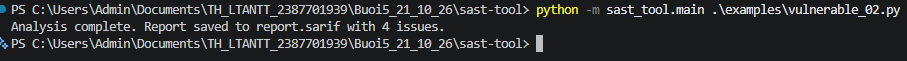

### 4.5. Kiểm tra các API Endpoints
Kiểm tra toàn bộ 5 endpoints REST API qua `curl` hoặc PowerShell `Invoke-RestMethod`:

| Phương thức | Đường dẫn URL | Mô tả chức năng | Dữ liệu đầu vào (Body) |
|---|---|---|---|
| **GET** | `/api/monitor` | Giám sát CPU, RAM, danh sách file mở của tiến trình | Không |
| **GET** | `/api/memory` | Kiểm tra rò rỉ bộ nhớ và kiểm thử tràn số nguyên | Không |
| **GET** | `/api/network` | Thống kê lưu lượng mạng vào/ra trên các giao diện | Không |
| **GET** | `/api/security` | Kiểm tra phát hiện các syscalls/hàm nhạy cảm | Không |
| **POST** | `/api/sandbox` | Thực thi lệnh bất kỳ trong Virtual Sandbox cô lập | JSON: `{"command": "echo test"}` |

#### Câu lệnh kiểm tra mẫu:
```bash
curl -X GET http://localhost:5000/api/monitor
curl -X GET http://localhost:5000/api/memory
curl -X GET http://localhost:5000/api/network
curl -X GET http://localhost:5000/api/security
curl -X POST http://localhost:5000/api/sandbox -H "Content-Type: application/json" -d "{\"command\": \"echo test\"}"
```

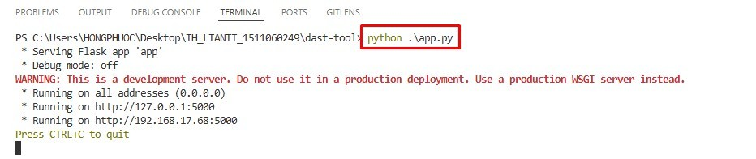

### 4.6. Push mã nguồn DAST lên GitHub
Đóng gói và đẩy toàn bộ mã nguồn công cụ DAST lên remote repository:

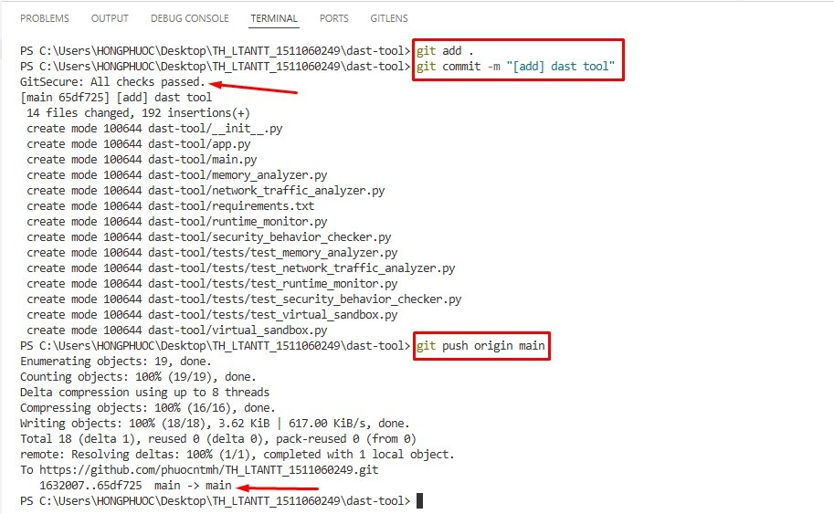

---

## 5. Bảng Tổng Hợp Kiểm Thử & Đánh Giá

| STT | Công cụ | Kiểm thử đơn vị (Unit Tests) | Chạy thực tế (CLI / API) | Đánh giá so với slide hướng dẫn |
|:---:|---|:---:|:---:|:---:|
| 1 | **SAST Tool** (`sast-tool/`) | **6/6 passed (100%)** | Quét thành công `vulnerable_01.py`, `vulnerable_02.py`, sinh file chuẩn `report.sarif`, xem tốt trên SARIF Viewer | Đúng 100% nội dung Mục 5.2 (Slide 1-13) |
| 2 | **DAST Tool** (`dast-tool/`) | **5/5 passed (100%)** | Chạy thành công `main.py` và toàn bộ 5/5 REST API endpoints trên `app.py` qua Flask | Đúng 100% nội dung Mục 5.4 (Slide 14-23) |
